# Implementation Plan: Base del Módulo 1 (Plataforma Compartida - Habitaciones, Inventario, Check-In y Check-Out)

**Date**: 2026-10-06  
**Spec**: [diccionario.md](../../contexto/diccionario.md), [hospitua.md](../../contexto/hospitua.md), [maquina-estados-habitacion.md](../../SPEC/referencias/maquina-estados-habitacion.md) y los `spec-*.md` de Módulo 1 en `documentos/SPEC/`. Este plan no implementa una feature específica: deja lista la plataforma técnica base que todos los planes de feature de Módulo 1 reutilizan.

---

## Summary

El **Módulo 1 (Gestión de Habitaciones e Inventario de Aforo, Check-In y Check-Out)** digitaliza la infraestructura física del hotel, controla la disponibilidad en tiempo real y gestiona directamente la admisión (`Check-In`) y salida (`Check-Out`) física de los huéspedes. Es la fuente de verdad del inventario habitacional (`Room`), de los 8 estados canónicos de su ciclo de vida y de las ocupaciones físicas reales (`Stay` y ocupantes inmutables `RoomGuest`).

Opera el **Panel de Recepción** al inicio de la jornada, consultando la copia local de la lista diaria de reservas (alimentada por la cola `m1.reservas.diarias.queue`) para las llegadas del día y las estancias activas locales para las salidas, operando de forma 100% autónoma sin peticiones REST a Módulo 2 para llegadas ni para Check-In. Durante el Check-In formaliza la ocupación transicionando atómicamente la habitación de `Reserved` a `Occupied`, captura y valida los datos de identidad de los huéspedes (`RoomGuest`: titular y acompañantes con nombres y apellidos separados, campos migratorios si extranjero) y notifica de forma asíncrona por la cola `m2.habitacion.checkin.queue` en un mensaje plano con `guests[]` conteniendo a todos los ocupantes (sin cola separada de extranjeros). Durante el Check-Out consulta síncronamente a Módulo 3 la liquidación (`SettlementSummary`: informativa o final), formaliza la salida transicionando la habitación a `PendingCleaning` (pasando de inmediato a la bandeja del Personal de limpieza) y notifica de forma asíncrona por la cola `m2.habitacion.checkout.queue` con `guests[]` conteniendo a todos los ocupantes para que Módulo 2 registre la salida de la habitación. También avisa de forma asíncrona por la cola `m2.habitacion.mantenimiento.queue` cada mantenimiento que se registra o cambia (bloqueos técnicos y reportes de daño), para que Módulo 2 actualice la disponibilidad que publica en Booking a través de Channex. Además, atiende solicitudes síncronas de Módulo 2 (consultar inventario por categoría o estado y consultar información de mantenimientos) y de Módulo 3 (consultar tarifa base).

Gestiona además el inventario (registro, edición, baja y reactivación de habitaciones por el Administrador; consulta del inventario y del historial de estados por el Gerente) y el ciclo operativo de limpieza y mantenimiento: el Personal de limpieza toma habitaciones desde su panel y confirma o libera su tarea activa; el Personal de mantenimiento reporta daños, programa bloqueos técnicos que un trabajo autónomo aplica en su fecha de inicio (o que se aplican de inmediato si inician el mismo día) e interviene las habitaciones mediante tareas de reparación. Toda transición de estado queda registrada por periodos en el historial de estados (`room_state_history`). Cada persona inicia sesión con su cuenta (`user_account`), y el Administrador registra, consulta, edita y desactiva las cuentas del personal (*Gestionar personal*, regla 14).

Este plan unifica el stack tecnológico, arquitectura hexagonal, modelo de persistencia relacional, contratos de integración (REST y colas RabbitMQ), política de resiliencia "HTTP a Cola", manejo de errores uniforme (siempre 4xx, nunca 500 no controlado) y la infraestructura transversal de pruebas.

---

## Technical Context

- **Language/Version**: Java 21 (LTS)
- **Primary Dependencies**: Spring Boot 4.1+ (Spring Framework 7), Spring Web MVC, Spring Data JPA, Bean Validation (Hibernate Validator), Lombok, Spring AMQP (RabbitMQ), Flyway, Resilience4j (`resilience4j-spring-boot4`), `spring-security-crypto`
- **Storage**: PostgreSQL 16+
- **Build Tool**: Maven 3.9+
- **Messaging**: RabbitMQ 3.13+ (Exchange topic `hospitua.events`, colas durables, Dead-Letter Exchange)
- **Testing**: JUnit 5, Mockito, Spring Boot Test, Testcontainers (PostgreSQL, RabbitMQ), MockRestServiceServer, WireMock (contratos con Módulo 2 y Módulo 3)
- **Target Platform**: Servidor Linux/Windows + Navegador Web moderno
- **Project Type**: Web Application monorepo estructurado (`backend/` + `frontend/`)
- **API**: REST JSON, con errores en el formato `ApiError` (sección "Formato Estándar de Error")
- **Frontend**: React 18+ con TypeScript (TSX) y Vite (componentes basados en las vistas prototipo en `documentos/vistas/recepcionista/`,`documentos/vistas/mantenimiento/`, `documentos/vistas/limpieza/`, `documentos/vistas/gerente/`, `documentos/vistas/administrador/`)
- **Version Control**: Git + GitHub (estrategia Gitflow)
- **Performance Goals**:
  - Transición física atómica de habitación (`Room.status`) < 50 ms p95.
  - Despacho de notificaciones asíncronas vía Outbox < 100 ms.
  - Carga del Panel de Recepción < 500 ms (consulta 100% local).
  - Consulta reactiva de liquidación a Módulo 3 en Check-Out < 800 ms.
  - Flujo de Check-In en mostrador: < 2 min (nacionales), < 3 min (extranjeros).
  - Flujo de Check-Out en mostrador: < 1 min desde recepción de liquidación.
- **Constraints**:
  - Ningún fallo externo (caída de Módulo 2 o Módulo 3) debe bloquear la entrega física o liberación de una habitación en el mostrador.
  - Cero operaciones financieras, cálculos de penalizaciones, IVA o cobros en pasarela dentro de Módulo 1 (responsabilidad exclusiva de Módulo 3).
  - Cero mutabilidad en la lista de `RoomGuest` tras completarse el Check-In.
  - Máquina de estados habitacional estricta: solo se admiten las transiciones canónicas descritas en `maquina-estados-habitacion.md`. Módulo 1 es el dueño exclusivo del ciclo de vida habitacional (decisiones B7 y B8: sin órdenes de bloqueo ni secuencias externas).
- **Scale/Scope**: Operación continua 24/7 en recepción, soporte para decenas/cientos de habitaciones, múltiples recepcionistas concurrentes, personal de limpieza y mantenimiento.

### Dependencias y herramientas transversales aprobadas

| Necesidad | Propuesta | Justificación |
| --- | --- | --- |
| Herramienta de compilación | Maven | Estándar empresarial con Spring Boot y soporte multi-módulo |
| Migraciones de Base de Datos | Flyway | Versionamiento determinista del esquema SQL en `src/main/resources/db/migration/` |
| Resiliencia y Timeouts REST | `RestClient` con timeouts + Resilience4j (`resilience4j-spring-boot4` con `spring-boot-starter-aspectj` para las anotaciones) | Evitar bloqueos ante lentitud o caída de Módulo 2 o Módulo 3 |
| Patrón Outbox Transaccional | Tabla `outbox_notification` + `@Scheduled` worker | Garantiza entrega eventual y consistencia atómica entre la base de datos y RabbitMQ |
| Cifrado de contraseñas | `spring-security-crypto` (`BCryptPasswordEncoder`), solo la librería de cifrado | Guardar las contraseñas de `user_account` cifradas para el inicio de sesión; no se usa la capa de seguridad (regla 14) |
| Paquete base backend | `com.hospitua.habitaciones` | Convención estándar del dominio |
| Pruebas de contrato REST | WireMock (junto con `MockRestServiceServer`) | Simular Módulo 2 y Módulo 3 con respuestas, errores y retrasos reales sobre HTTP en las pruebas de contrato |
| Formato de código | Spotless con palantir-java-format (`./mvnw spotless:apply`; `verify` falla si el código no está formateado) | Formato uniforme sin discusiones en las revisiones |

---

## Comunicación entre módulos

Regla arquitectónica de HOSPITUA:

- **Proactiva** (el módulo avisa la ocurrencia de un evento de negocio y no requiere esperar respuesta sincrónica) → **Cola RabbitMQ**.
- **Reactiva** (solicitud bajo demanda que requiere un dato o confirmación síncrona inmediata) → **REST**.

### Matriz de Integración de Módulo 1

| Interacción | Dirección | Mecanismo | Tipo | Feature / Caso de Uso |
| --- | --- | --- | --- | --- |
| **Notificación de Check-In** | M1 → M2 | Cola RabbitMQ (`m2.habitacion.checkin.queue` / routing key `habitacion.checkin`) con `guests[]` completo plano | Proactiva | `plan-registrar-check-in.md` |
| **Notificación de Check-Out** | M1 → M2 | Cola RabbitMQ (`m2.habitacion.checkout.queue` / routing key `habitacion.checkout`) con `guests[]` completo plano | Proactiva | `plan-registrar-check-out.md` |
| **Aviso de Mantenimiento** | M1 → M2 | Cola RabbitMQ (`m2.habitacion.mantenimiento.queue` / routing key `habitacion.mantenimiento`), mensaje plano con `maintenanceId`, `action` y fechas | Proactiva | `plan-programar-bloqueo-tecnico-para-habitacion.md`, `plan-marcar-habitacion-inhabilitada-por-reparaciones.md`, `plan-confirmar-reparacion-finalizada.md` (pieza compartida: T025) |
| **Ingestión de Reservas Diarias** | M2 → M1 | Cola RabbitMQ (`m1.reservas.diarias.queue` / routing keys `reserva.lista-del-dia` y `reserva.lista-del-dia.actualizacion`) | Proactiva | `plan-consultar-reservas.md` |
| **Consultar Inventario de Habitaciones** | M2 → M1 | REST GET (`/api/rooms?categoryRoom={cat}` y `/api/rooms/{roomId}`) — solo habitaciones vendibles (sin `Inactive`) | Reactiva | `spec-consultar-inventario-habitaciones.md` |
| **Consultar Disponibilidad de Reservas para Mantenimiento/Baja** | M1 → M2 | REST GET (`/api/reservations?dateFrom={d1}&dateTo={d2}&roomId={id}`, cabecera `X-Client: MODULE1`) — solo para Mantenimiento/Administración | Reactiva | `plan-consultar-reservas.md` |
| **Consultar Liquidación** | M1 → M3 | REST GET (`/api/settlements?reservationRef={ref}&checkInDate={in}&checkOutDate={out}&source={src}&roomId={room}&categoryRoom={cat}`) | Reactiva | `plan-consultar-liquidacion.md`, `plan-registrar-check-out.md` |
| **Consultar Tarifa Base** | M3 → M1 | REST GET (`/api/rooms/{roomId}/base-rate`) | Reactiva | `plan-consultar-tarifa-base.md`, `spec-consultar-tarifa-base.md` |
| **Consultar Información de Mantenimientos** | M2 → M1 | REST GET (`/api/rooms/{roomId}/maintenances?startDate={d1}&endDate={d2}`) — M2 la consulta antes de asignar una habitación a una reserva y para calcular la disponibilidad que envía a Channex (después de cada aviso de mantenimiento y a las 03:00, de hoy a 90 días) | Reactiva | `spec-consultar-informacion-mantenimientos.md` |

### Convenciones de Mensajería (RabbitMQ)

- **Exchange**: `hospitua.events` (Tipo: `topic`, durable).
- **Colas / Routing Keys emitidas por Módulo 1 hacia Módulo 2**:
  - `m2.habitacion.checkin.queue` (routing key `habitacion.checkin`): Disparada por `POST /api/check-in`, al confirmar el paso 3 (Confirmación) del flujo de 4 pasos del Check-In. Emite mensaje plano con `messageId`, `sequenceNumber`, `reservationRef`, `roomId`, `movementType = ENTRY`, `movementDate = checkInDate`, y el array `guests[]` con todos los ocupantes (nacionales y extranjeros; `birthDate` para todos y `originPlace`, `destinationPlace` incluidos únicamente si la nacionalidad es distinta de Colombia; `documentType` es `RC`, `TI`, `CC`, `CE`, `PAS` o `NIT`). Sin cola separada de extranjeros.
  - `m2.habitacion.checkout.queue` (routing key `habitacion.checkout`): Disparada por `POST /api/check-out`, al confirmar el paso 4 (Confirmación) del flujo de 5 pasos del Check-Out. Emite mensaje plano con `messageId`, `sequenceNumber`, `reservationRef`, `roomId`, `movementType = DEPARTURE`, `movementDate = checkOutDate`, y el array `guests[]` con todos los ocupantes (reutilizando los datos migratorios capturados en Check-In).
  - `m2.habitacion.mantenimiento.queue` (routing key `habitacion.mantenimiento`): aviso de mantenimiento (pieza compartida `MaintenanceNoticePublisher`, T025). Mensaje plano con `messageId`, `sequenceNumber`, `maintenanceId`, `action` (`SCHEDULED`, `UPDATED` o `CANCELLED`), `roomId`, `categoryRoom`, `startDate` y `endDate` (inclusivos: la habitación no se vende ninguna de esas noches) y, solo con `UPDATED`, `previousStartDate` y `previousEndDate`. Módulo 2 no responde: con cada aviso recalcula esas fechas con *Consultar información de mantenimientos* y envía la disponibilidad a Channex. Se publica:
    - `SCHEDULED` al programar un bloqueo técnico (`maintenanceId` = id del `TechnicalBlockReport`; inicio y fin estimado) y al reportar un daño (`maintenanceId` = id del `DamageReport`; `startDate` = `endDate` = hoy, el mismo cruce del día actual que responde la consulta de mantenimientos).
    - `UPDATED` al confirmar el fin de la reparación de un `TechnicalBlock` en una fecha distinta de la estimada (`endDate` = fecha de cierre; `previousStartDate` y `previousEndDate` = rango original).
    - `CANCELLED` al confirmar el fin de la reparación de un `DisabledForRepairs` (`maintenanceId` = id del `DamageReport` que la originó; `startDate` = `endDate` = fecha de cierre).
    - `SCHEDULED` diario a las 00:00 (America/Bogota), con `startDate` = `endDate` = hoy, por cada habitación en `DisabledForRepairs` (`maintenanceId` = id de su último `DamageReport`, el mismo que usará `CANCELLED`) y por cada informe de bloqueo técnico `Applied` vencido (`maintenanceId` = id del informe). Lo publica `DailyMaintenanceNoticeService`, con un disparo propio separado del trabajo de bloqueos (regla 10), en una transacción sin bloqueo de filas: un aviso desactualizado es inocuo, porque Módulo 2 recalcula con la consulta. Cierra la ventana hasta el recálculo de las 03:00 de Módulo 2 (punto abierto 5).
    - No se publica cuando un bloqueo termina en su fecha estimada, cuando un informe pasa a `Expired` (caduca), ni al aplicarse un mantenimiento programado (trabajo diario de bloqueos o fin de limpieza), porque ninguna noche cambia. Un bloqueo técnico no se modifica ni se cancela (*Programar bloqueo técnico* FR-021): `UPDATED` y `CANCELLED` sobre un bloqueo quedan para futuros casos de uso.
- **Cola recibida por Módulo 1 desde Módulo 2**:
  - `m1.reservas.diarias.queue`: Ingesta asíncrona para alimentar y actualizar la copia local de reservas del día:
    - Routing key `reserva.lista-del-dia`: Lista diaria de reservas `ACTIVE` con `startDate = hoy` recibida a las 00:00 (purga del día anterior, `sequenceNumber = 1`, transiciones automáticas `Available → Reserved`).
    - Routing key `reserva.lista-del-dia.actualizacion`: Actualizaciones continuas durante el día con acciones `ADDED`, `UPDATED` o `REMOVED` (libera `Reserved → Available`).
- **Mensajes fallidos**: el Dead-Letter Exchange envía a la cola `m1.reservas.diarias.dlq` los mensajes ilegibles o sin `messageId`, `sequenceNumber`, `operationalDate` o `reservationRef`, sin aplicarlos, y los que fallan por un error temporal después de 3 reintentos con espera creciente (`spec-consultar-reservas.md`, FR-003).
- **Control de Idempotencia y Secuencia**:
  - Todo mensaje incluye `messageId` único para descarte de duplicados contra `daily_reservation_message_log`.
  - Mensajes recibidos: se aplican en orden de `sequenceNumber` dentro del mismo `operationalDate`. Un `sequenceNumber` mayor que el esperado se aplica y se registra como `SEQUENCE_GAP`, sin detener la ingesta. Ante varios cambios de la misma reserva se conserva el de mayor secuencia: un `ADDED`, `UPDATED` o `REMOVED` cuya secuencia sea menor o igual que la última aplicada para esa `reservationRef` en el día se descarta y se registra en el log (`daily_reservation_message_log` guarda la `reservation_ref` de cada actualización). `updatedAt` es solo informativo y no decide el orden. Los mensajes de un `operationalDate` anterior al de la copia local se descartan (`plan-consultar-reservas.md`, T012).
  - Mensajes enviados: `sequenceNumber` creciente por cola, que nunca se reinicia (contrato de Módulo 2).
- **Estructura estándar de los mensajes salientes (formato plano unificado)**:

  ```json
  {
    "messageId": "UUIDv4",
    "sequenceNumber": 1,
    "reservationRef": "RES-000123",
    "roomId": "room-uuid",
    "movementType": "ENTRY | DEPARTURE",
    "movementDate": "YYYY-MM-DD",
    "guests": [
      {
        "firstName": "string",
        "lastName": "string",
        "documentType": "string",
        "documentNumber": "string",
        "nationality": "string",
        "birthDate": "YYYY-MM-DD",
        "originPlace": "Ciudad, País",
        "destinationPlace": "Ciudad, País"
      }
    ]
  }
  ```

### Traducción de Respuestas HTTP a Cola ("HTTP a Cola") y Resiliencia

De acuerdo con el diagrama arquitectónico oficial `mod-1-2-3.drawio`:

1. **Desacoplamiento asíncrono**: Check-In y Check-Out son eventos físicos que se consolidan **localmente y de forma inmediata** en la base de datos de Módulo 1 (`Stay`, `Room.status = Occupied` / `PendingCleaning`, `RoomGuest`).
2. **Patrón Transaccional Outbox**: La notificación a Módulo 2 se inserta en la tabla `outbox_notification` dentro de la **misma transacción ACID** que el hecho que se notifica (check-in, check-out o mantenimiento registrado o cambiado).
3. **Despacho no bloqueante**: Un publicador asíncrono toma los registros pendientes y los deposita en RabbitMQ con acuse de recibo del broker (Publisher Confirms).
4. **Resiliencia ante caídas externas**: Si Módulo 2 está caído, con alta latencia o con fallos de base de datos, **el huésped no se retiene en el mostrador**. La habitación física queda entregada o enviada a limpieza, y la notificación se reintenta automáticamente en segundo plano con backoff exponencial. Cada mensaje se reintenta por separado: un mensaje que no se logra publicar no frena a los siguientes, porque Módulo 2 no reordena las notificaciones y registra los saltos de secuencia sin detenerse (FR-023 de su *update-reservation*). Agotados los reintentos, el mensaje queda en `FAILED` y se emite una alerta para revisión humana.

### Consideraciones de Channex (Booking)

Módulo 2 publica en Booking, a través de Channex, la disponibilidad de cada categoría por noche: habitaciones vendibles − habitaciones ocupadas por reservas − habitaciones en mantenimiento. Booking vende con esa copia y no consulta a Módulo 1 ni a Módulo 2, y una reserva de Booking no se puede rechazar. Por eso, para Módulo 1:

- **Avisos de mantenimiento**: son lo que actualiza Booking al momento ("Convenciones de Mensajería"). Si un aviso se pierde, Módulo 2 lo corrige a las 03:00, cuando recalcula todo con *Consultar inventario de habitaciones* y *Consultar información de mantenimientos*.
- **Categorías**: Channex admite como máximo 20 tipos de habitación y no los borra. Módulo 1 usa las 4 categorías fijas del enum (`SENCILLA`, `DOBLE`, `SUITE`, `BOUTIQUE`, regla 12), que no se renombran; renombrar una crearía un tipo nuevo en Channex.
- **Capacidad**: bajar `max_capacity` con *Editar habitación* puede requerir que un administrador de Módulo 2 ajuste el mapeo en Channex; mientras tanto, una reserva de Booking con más personas llega en conflicto (`plan-editar-habitacion.md`).
- **Bajas de habitaciones**: Módulo 2 las toma de *Consultar inventario de habitaciones* (que excluye las `Inactive`) en su recálculo de las 03:00; no hay aviso por cola de la baja (punto abierto 4).

---

## Contratos REST

**Convención de respuestas**: una creación responde `201` con el id del recurso creado y solo lo que la interfaz consume; una acción sobre un recurso existente responde `204` sin cuerpo.

### 1. Endpoints que Módulo 1 EXPONE (servicios propios)

| Método y Ruta | Consumidor | Propósito |
| --- | --- | --- |
| `POST /api/auth/login` | Todos los usuarios de Módulo 1 (Frontend M1) | Inicio de sesión: valida usuario y contraseña contra `user_account` y devuelve quién es (`username`, `fullName`, `area`). Identifica al usuario; no da permisos (regla 14) |
| `GET /api/staff` | Administrador (Frontend M1) | Lista del personal con filtros por área y estado, búsqueda y paginación (`plan-gestionar-personal.md`) |
| `POST /api/staff` | Administrador (Frontend M1) | Registrar una cuenta del personal (`plan-gestionar-personal.md`) |
| `GET /api/staff/{username}` | Administrador (Frontend M1) | Una cuenta, para editar o desactivar (`plan-gestionar-personal.md`) |
| `PATCH /api/staff/{username}` | Administrador (Frontend M1) | Editar nombre, área o contraseña de una cuenta activa (`plan-gestionar-personal.md`) |
| `POST /api/staff/{username}/deactivation` | Administrador (Frontend M1) | Desactivar una cuenta sin borrarla (`plan-gestionar-personal.md`) |
| `GET /api/reception/arrivals?query={q}` | Recepcionista (Frontend M1) | Pestaña Llegadas del Panel de Recepción: habitaciones de las reservas del día desde la copia local, con búsqueda por código, documento o nombre (`plan-consultar-panel-recepcion.md`) |
| `GET /api/reception/departures?query={q}` | Recepcionista (Frontend M1) | Pestaña Salidas del Panel de Recepción: estancias activas locales (`plan-consultar-panel-recepcion.md`) |
| `GET /api/reception/panel/kpis` | Recepcionista (Frontend M1) | Indicadores del Panel de Recepción (`plan-consultar-panel-recepcion.md`) |
| `GET /api/check-in/validate?reservationRef={ref}&roomId={roomId}` | Recepcionista (Frontend M1) | Paso 1 del Check-In: validación de la reserva contra la copia local y de la habitación en `Reserved` (`plan-registrar-check-in.md`) |
| `POST /api/check-in` | Recepcionista (Frontend M1) | Formalización del Check-In al confirmar el paso 3 del flujo de 4 pasos (validar reserva, datos de huéspedes, confirmación, éxito): `Stay`, `RoomGuest`, transición atómica a `Occupied` y outbox (`plan-registrar-check-in.md`) |
| `POST /api/check-out` | Recepcionista (Frontend M1) | Formalización del Check-Out al confirmar el paso 4 del flujo de 5 pasos (estancia, liquidación, pago, confirmación, liberar habitación): cierre de `Stay`, transición a `PendingCleaning` y outbox (`plan-registrar-check-out.md`) |
| `GET /api/check-out/active-stay?reservationRef={ref}&roomId={roomId}` | Recepcionista (Frontend M1) | Paso 1 del Check-Out: datos locales de la estancia activa de esa habitación (`plan-registrar-check-out.md`) |
| `GET /api/stays/{stayId}/settlement` | Recepcionista (Frontend M1) | Pasos 2 y 3 del Check-Out: liquidación de la estancia obtenida de Módulo 3 (`plan-consultar-liquidacion.md`, Endpoint 2) |
| `GET /api/rooms/inventory` | Gerente, Administrador (Frontend M1) | Inventario de habitaciones para las vistas internas: paginado (10), filtrable por número, tipo, piso y estado, con las `Inactive` incluidas (`plan-consultar-inventario-habitaciones.md`) |
| `GET /api/rooms/inventory/{roomId}` | Administrador (Frontend M1) | Detalle completo de una habitación con su `version`, para los formularios de edición y baja (`plan-consultar-inventario-habitaciones.md`) |
| `GET /api/rooms?categoryRoom={cat}` | Módulo 2 | Lista sin paginar de las habitaciones vendibles de la categoría, sin `Inactive`, con `id`, `roomNumber`, `categoryRoom` y `maxCapacity` (`plan-consultar-inventario-habitaciones.md`) |
| `GET /api/rooms/{roomId}` | Módulo 2 | Habitación vendible por su ID: solo `id`, `roomNumber`, `categoryRoom` y `maxCapacity`, y 404 `ROOM_NOT_FOUND` si la habitación no existe o está `Inactive` (`plan-consultar-inventario-habitaciones.md`) |
| `POST /api/rooms` | Administrador (Frontend M1) | Registrar habitación en `Available` con su periodo inicial en el historial (`plan-registrar-habitacion.md`) |
| `PATCH /api/rooms/{roomId}` | Administrador (Frontend M1) | Editar los atributos de una habitación `Available` (`plan-editar-habitacion.md`) |
| `POST /api/rooms/{roomId}/decommission` | Administrador (Frontend M1) | Dar de baja: consulta a Módulo 2 las reservas vigentes desde hoy y, si no hay, pasa la habitación a `Inactive` (`plan-dar-de-baja-habitacion.md`) |
| `GET /api/rooms/{roomId}/decommission` | Administrador (Frontend M1) | Datos de la baja vigente para confirmar la reactivación (`plan-marcar-habitacion-como-disponible.md`) |
| `POST /api/rooms/{roomId}/reactivation` | Administrador (Frontend M1) | Reactivar una habitación: `Inactive` → `Available` (`plan-marcar-habitacion-como-disponible.md`) |
| `GET /api/room-state-history` | Gerente (Frontend M1) | Historial de estados paginado con filtros por habitación, categoría, estado y fechas, con responsable y flujo de origen (`plan-consultar-historial-de-estados.md`) |
| `GET /api/rooms/{roomId}/base-rate` | Módulo 3 | Consulta reactiva de la tarifa base configurada para la habitación (`plan-consultar-tarifa-base.md`) |
| `GET /api/rooms/{roomId}/maintenances?startDate={d1}&endDate={d2}` | Módulo 2 (reservas directas y cálculo de disponibilidad para Channex); *Programar Bloqueo Técnico* lo usa de forma interna, sin REST | Verificación de cruces con mantenimientos programados o en curso para una estadía (`startDate` = llegada, `endDate` = salida, que no se considera ocupada); responde `available` (solo mantenimientos) y la lista `conflicts` con `maintenanceStart` y `maintenanceEnd` de cada cruce, o "habitación no encontrada" (`spec-consultar-informacion-mantenimientos.md`) |
| `GET /api/cleaning/panel` | Personal de limpieza (Frontend M1) | Panel de limpieza: habitaciones en `PendingCleaning` y `Available` (primero las pendientes) con su última limpieza, o la tarea activa del miembro con la fila de su habitación (`plan-consultar-panel-limpieza.md`) |
| `POST /api/cleaning/tasks` | Personal de limpieza (Frontend M1) | Iniciar la limpieza de una habitación: transición a `InCleaning` y creación de la `CleaningTask`; responde `201` con `{taskId}` (`plan-marcar-habitacion-en-limpieza.md`) |
| `POST /api/cleaning/tasks/{taskId}/complete` | Personal de limpieza (Frontend M1) | Confirmar fin de limpieza, con daño opcional: `Available`, `Reserved`, `DisabledForRepairs` o `TechnicalBlock` (según la regla 6 de la máquina de estados); responde `204` (`plan-confirmar-fin-de-limpieza.md`) |
| `POST /api/cleaning/tasks/{taskId}/release` | Personal de limpieza (Frontend M1) | Liberar la tarea de limpieza: la habitación vuelve a `PendingCleaning`; responde `204` (`plan-confirmar-fin-de-limpieza.md`) |
| `POST /api/rooms/{roomId}/damage-reports` | Personal de limpieza y de mantenimiento (Frontend M1) | Reportar daño: `Available` → `DisabledForRepairs` con su `DamageReport`; responde `201` con `{damageReportId}` (`plan-marcar-habitacion-inhabilitada-por-reparaciones.md`) |
| `GET /api/rooms/{roomId}/damage-reports/latest` | Personal de mantenimiento (Frontend M1) | "Ver informe" del daño que inhabilitó la habitación (`plan-marcar-habitacion-inhabilitada-por-reparaciones.md`) |
| `GET /api/maintenance/panel` | Personal de mantenimiento (Frontend M1) | Panel de mantenimiento: todas las habitaciones excepto las `Inactive` (primero las que requieren intervención) con su informe de bloqueo técnico (`maintenance`), o la tarea activa del miembro con la fila de su habitación (`activeTask`) (`plan-consultar-panel-mantenimiento.md`) |
| `POST /api/maintenance/tasks` | Personal de mantenimiento (Frontend M1) | "Iniciar reparaciones": crea la `ReparationTask`; responde `201` con `{taskId}` (`plan-confirmar-reparacion-finalizada.md`) |
| `POST /api/maintenance/tasks/{taskId}/complete` | Personal de mantenimiento (Frontend M1) | Confirmar fin de reparación: la habitación pasa a `PendingCleaning`; responde `204` (`plan-confirmar-reparacion-finalizada.md`) |
| `POST /api/maintenance/tasks/{taskId}/release` | Personal de mantenimiento (Frontend M1) | Liberar la tarea de reparación sin cambiar la habitación; responde `204` (`plan-confirmar-reparacion-finalizada.md`) |
| `POST /api/rooms/{roomId}/technical-blocks` | Personal de mantenimiento (Frontend M1) | Programar bloqueo técnico; se aplica de inmediato si inicia hoy; responde `201` con `{technicalBlockId, status}` (`plan-programar-bloqueo-tecnico-para-habitacion.md`) |
| `GET /api/rooms/{roomId}/technical-blocks/current` | Personal de mantenimiento (Frontend M1) | "Ver informe" del bloqueo técnico aplicado o, si no hay, del programado más próximo (`plan-programar-bloqueo-tecnico-para-habitacion.md`) |

### 2. Endpoints que Módulo 1 CONSUME (clientes de otros módulos)

| Servicio Externo | Método y Ruta | Propósito |
| --- | --- | --- |
| **Módulo 2 (Reservas)** | `GET /api/reservations?dateFrom={d1}&dateTo={d2}&roomId={id}`, con la cabecera `X-Client: MODULE1` | Verificación de conflicto de reservas para el Personal de mantenimiento/Administrador antes de bloquear o dar de baja una habitación |
| **Módulo 3 (Liquidación)** | `GET /api/settlements?reservationRef={ref}&checkInDate={in}&checkOutDate={out}&source={src}&roomId={room}&categoryRoom={cat}` | Consulta reactiva síncrona de la liquidación (informativa o final) y desglose financiero en el paso 2 de Check-Out |

### Formato Estándar de Error (`ApiError`)

Toda excepción o rechazo funcional se traduce a un cuerpo JSON estandarizado. `errorCode`, `message`, `timestamp` y `path` son obligatorios; `details` es opcional y aporta contexto (por ejemplo, `currentStatus` o la regla incumplida). `timestamp` usa la hora de Colombia (regla 6). Los códigos de error de cada endpoint los define su plan; los que comparten varios planes están en el "Catálogo de errores comunes". `message` es un texto genérico de respaldo: el de la columna "Mensaje" del catálogo o, si no lo fija, uno neutral. La interfaz muestra el texto de la tabla de errores de su propio plan según el `errorCode`.

```json
{
  "errorCode": "ROOM_INVALID_STATE",
  "message": "La habitación está Ocupada; ahora no se puede limpiar.",
  "timestamp": "2026-10-06T10:30:00-05:00",
  "path": "/api/cleaning/tasks",
  "details": { "currentStatus": "Occupied" }
}
```

- **HTTP 400**: Errores de validación o datos faltantes.
- **HTTP 401**: Usuario o contraseña incorrectos, o cuenta desactivada, solo en `POST /api/auth/login` (`INVALID_CREDENTIALS`).
- **HTTP 403**: La tarea pertenece a otro miembro del personal (`TASK_NOT_OWNED`).
- **HTTP 404**: Recurso inexistente (ej. habitación no encontrada).
- **HTTP 409**: Conflicto de concurrencia optimista o violación del ciclo de vida de la máquina de estados habitacional.
- **HTTP 503**: Un módulo externo no responde y la operación no puede verificarse (por ejemplo, `MODULE_2_UNAVAILABLE`).
- **HTTP 500 no controlado PROHIBIDO**: Todo error inesperado es capturado por `@RestControllerAdvice`, registrado con identificador de correlación en logs y devuelto al cliente con código de error controlado.

#### Catálogo de errores comunes

`GlobalExceptionHandler` traduce cada excepción a su `errorCode`. Estos códigos se repiten en varios planes y siempre salen de la misma excepción; los demás los define el plan de su endpoint, en la columna "Excepción" de su tabla de errores. Cuando la columna "Mensaje" fija un texto, los planes lo copian literal en su tabla de errores; cuando no lo fija, cada plan define en su tabla el texto que muestra la interfaz, y `message` lleva el texto genérico de respaldo.

| errorCode | HTTP | Excepción | Dónde se define | Mensaje |
| --- | --- | --- | --- | --- |
| `VALIDATION_ERROR` | 400 | `MethodArgumentNotValidException` (DTO de request del controlador con `@Valid`, incluidas sus restricciones de clase; regla 1) o `ConstraintViolationException` (parámetros con `@Validated`); un parámetro con tipo inválido (`MethodArgumentTypeMismatchException`) y un cuerpo JSON ilegible o con un valor que no se puede convertir, como una fecha inexistente (`HttpMessageNotReadableException`), también responden `VALIDATION_ERROR`. `details.field` indica el campo | Spring (Bean Validation) | Lo define el plan del endpoint, según el campo |
| `INVALID_CREDENTIALS` | 401 | `InvalidCredentialsException` | Solo en `POST /api/auth/login`: usuario inexistente, contraseña incorrecta o cuenta desactivada (`active = false`), con el mismo mensaje para no revelar cuál fue | "Usuario o contraseña incorrectos." |
| `CURRENT_USER_REQUIRED` | 400 | `CurrentUserRequiredException` | Una petición del frontend que usa el usuario actual (registra un responsable o consulta las tareas del miembro) llega sin el encabezado `X-User`, con un usuario que no existe o con una cuenta desactivada (regla 14). | "Tu sesión terminó. Inicia sesión de nuevo." |
| `ROOM_NOT_FOUND` | 404 | `RoomNotFoundException` | Plan base (`domain/exception/`) | "No se encontró la habitación." |
| `ROOM_INVALID_STATE` | 409 | `InvalidRoomTransitionException`, con `details.currentStatus` | Plan base (`domain/exception/`) | Lo define el plan del endpoint, con el `{estado}` actual en español |
| `CONCURRENT_UPDATE` | 409 | `ObjectOptimisticLockingFailureException` (control optimista de `version`); un plan puede mapear también la violación de un índice único (`DataIntegrityViolationException`) | Spring Data JPA | "La habitación acaba de cambiar. Vuelve a intentarlo." Los formularios de edición (*Editar habitación*, *Gestionar personal*) usan su propio texto, que pide recargar los datos |
| `TASK_NOT_OWNED` | 403 | `TaskNotOwnedException` | Plan base (`domain/exception/`) | Lo define el plan del endpoint (limpieza o reparación) |
| `TASK_NOT_FOUND` | 404 | `TaskNotFoundException` | Plan base (`domain/exception/`) | Lo define el plan del endpoint (limpieza o reparación) |
| `TASK_ALREADY_CLOSED` | 409 | `TaskAlreadyClosedException` | Plan base (`domain/exception/`) | "Esta tarea ya fue cerrada." |
| `ACTIVE_TASK_EXISTS` | 409 | `ActiveTaskExistsException`; la lanza el dominio o el adaptador del repositorio al traducir el índice único de tarea abierta por miembro (`DataIntegrityViolationException`) | Plan base (`domain/exception/`) | Lo define el plan del endpoint (limpieza o reparación) |
| `ROOM_TASK_EXISTS` | 409 | `RoomTaskExistsException`; la lanza el dominio o el adaptador del repositorio al traducir el índice único de tarea abierta por habitación en `cleaning_task` o `reparation_task` (`DataIntegrityViolationException`): otro miembro ya tiene una tarea abierta sobre la habitación | Plan base (`domain/exception/`, T020). En limpieza es solo respaldo del índice (con el bloqueo de la regla 13 no se alcanza en flujo normal); en reparación lo emite la comprobación de *Iniciar reparaciones* con la fila bloqueada (`plan-confirmar-reparacion-finalizada.md`), con el índice como respaldo | Lo define el plan del endpoint (limpieza o reparación) |
| `INVALID_DATE_RANGE` | 400 | `InvalidDateRangeException`, con `details.rule` | `plan-consultar-informacion-mantenimientos.md` (T001); la reutilizan *Programar bloqueo técnico* y *Consultar historial de estados* | El de la regla, en la tabla "Mensajes por regla" de `plan-consultar-informacion-mantenimientos.md` |
| `RESERVATION_CONFLICT` | 409 | `ReservationConflictException`, con `details.reservations` | `plan-consultar-reservas.md` (T028); la reutilizan *Programar bloqueo técnico* y *Dar de baja* | Lo define el plan del endpoint |
| `MODULE_2_UNAVAILABLE` | 503 | `ExternalModule2UnavailableException` | `plan-consultar-reservas.md` | Lo define el plan del endpoint |

---

## Project Structure

### Documentation

```text
documentos/
├── contexto/
│   ├── arquitectura-hexagonal.md     # Capas, puertos, adaptadores y regla de dependencia
│   ├── diccionario.md
│   └── hospitua.md
├── diagramas/
│   ├── cdu-modulo-1-d.drawio         # Diagrama de casos de uso (fuente)
│   ├── cdu-modulo-1.png
│   ├── cdu-modulo-1.md               # Copia en XML de draw.io de cdu-modulo-1-d.drawio
│   ├── entidad-relacion.md           # Diagrama entidad-relación por áreas
│   ├── maquina-de-estados.png
│   ├── mod-1-2-3.drawio.xml          # Integración entre los tres módulos
│   └── mod-1-2-3.png
├── SPEC/
│   ├── referencias/maquina-estados-habitacion.md
│   └── spec-*.md                     # Un spec por caso de uso de Módulo 1
├── PLAN/
│   ├── base/
│   │   └── plan.md                   # Este archivo (plataforma técnica compartida)
│   └── plan-*.md                     # Un plan por caso de uso (ej. plan-registrar-check-out.md)
└── vistas/                           # Prototipos HTML/CSS por área
    ├── recepcionista/
    ├── limpieza/
    ├── mantenimiento/
    ├── administrador/                # Incluye las vistas 12 a 16 de Gestionar personal
    └── gerente/
```

### Source Code (Arquitectura Hexagonal — Puertos y Adaptadores)

```text
backend/
├── pom.xml
├── Dockerfile
└── src/
    ├── main/
    │   ├── java/com/hospitua/habitaciones/
    │   │   ├── domain/                                       # CAPA DE DOMINIO (Lógica de negocio pura, sin dependencias externas)
    │   │   │   ├── model/                                    # Entidades, Enums y Value Objects del núcleo
    │   │   │   │   ├── Room.java                             # Entidad de habitación física y reglas de aforo
    │   │   │   │   ├── RoomStatus.java                       # Enum con los 8 estados canónicos
    │   │   │   │   ├── RoomCategory.java                     # Enum: SENCILLA, DOBLE, SUITE, BOUTIQUE (plan-registrar-habitacion.md)
    │   │   │   │   ├── RoomAttributeChange.java              # Value Object: campo, valor anterior y valor nuevo (plan-editar-habitacion.md)
    │   │   │   │   ├── RoomDecommission.java                 # Baja de una habitación (plan-dar-de-baja-habitacion.md)
    │   │   │   │   ├── DecommissionReason.java               # Enum: PERMANENT_REMODELING, FLOOR_CLOSURE, ADMINISTRATIVE_DECISION, OTHER
    │   │   │   │   ├── Stay.java                             # Estancia física formalizada en check-in (source: `DIRECTA` o nombre de la OTA, tal como llega de Módulo 2)
    │   │   │   │   ├── RoomGuest.java                        # Ocupante físico inmutable (isReservationGuest, identidad)
    │   │   │   │   ├── ForeignGuestData.java                 # Value Object migratorio SIRE (originPlace, destinationPlace) # Sin uso asignado
    │   │   │   │   ├── MovementType.java                     # Enum: ENTRY (check-in) / DEPARTURE (check-out); lo usan CheckInMessagePayload y CheckOutMessagePayload
    │   │   │   │   ├── MaintenanceNoticeAction.java          # Enum: SCHEDULED, UPDATED, CANCELLED del aviso de mantenimiento (T025)
    │   │   │   │   ├── CheckOutDetails.java                  # Datos de cierre de la estancia (plan-registrar-check-out.md) # Sin uso asignado
    │   │   │   │   ├── ReceptionDashboardKpis.java           # Indicadores del panel de recepción (plan-consultar-panel-recepcion.md)
    │   │   │   │   ├── ArrivalGroup.java                     # Reserva del día con sus habitaciones pendientes (pendingRooms, totalRooms, rooms) (plan-consultar-reservas.md, T019)
    │   │   │   │   ├── ArrivalItemSummary.java               # Llegada del día, una fila por habitación: elemento de ArrivalGroup.rooms (plan-consultar-panel-recepcion.md)
    │   │   │   │   ├── DepartureSummary.java                 # Salida (estancia activa) (plan-consultar-panel-recepcion.md)
    │   │   │   │   ├── ReservationSummary.java               # Resumen contractual consumido reactivamente de Módulo 2 # Sin uso asignado
    │   │   │   │   ├── DailyReservation.java                 # Copia local de una reserva del día (plan-consultar-reservas.md)
    │   │   │   │   ├── DailyReservationRoom.java             # Habitación de una reserva del día (plan-consultar-reservas.md)
    │   │   │   │   ├── DailyReservationMessageLog.java       # Registro de idempotencia de la cola diaria (plan-consultar-reservas.md)
    │   │   │   │   ├── EnrichedReservationSummary.java       # Reserva del día enriquecida con el estado de la habitación (plan-consultar-reservas.md) # Sin uso asignado
    │   │   │   │   ├── ReservationConflictQuery.java         # Value Object (roomId, startDate, endDate) (plan-consultar-reservas.md)
    │   │   │   │   ├── ReservationConflictResult.java        # Resultado de cruce (hasConflict, conflicts) (plan-consultar-reservas.md)
    │   │   │   │   ├── ReservationTrigger.java               # Enum: DAILY_LIST, ADDED_UPDATE, CLEANING_END (plan-marcar-habitacion-reservada.md)
    │   │   │   │   ├── MarkRoomReservedOutcome.java          # Enum: RESERVED, ALREADY_RESERVED, CONFLICT, ROOM_NOT_FOUND (plan-marcar-habitacion-reservada.md)
    │   │   │   │   ├── SettlementRequest.java                # Datos enviados a Módulo 3 (plan-consultar-liquidacion.md)
    │   │   │   │   ├── SettlementSummary.java                # Resumen informativo de liquidación de Módulo 3 (invoiceNumber)
    │   │   │   │   ├── SettlementAvailabilityStatus.java     # Disponibilidad de la liquidación (plan-consultar-liquidacion.md)
    │   │   │   │   ├── RoomStateHistory.java                 # Periodo de una habitación en un estado (historial común)
    │   │   │   │   ├── RoomAuditEntry.java                   # Evento de auditoría que no es transición (conflicto, edición, check-in, check-out) (T017)
    │   │   │   │   ├── RoomAuditEventType.java               # Enum: RESERVATION_STATE_CONFLICT, ROOM_EDITED, CHECK_IN, CHECK_OUT (T017)
    │   │   │   │   ├── CleaningTask.java                     # Tarea de limpieza de un miembro del Personal de limpieza
    │   │   │   │   ├── CleaningTaskOutcome.java              # Enum: Completed / DamageReported / Released; countsAsCleaning() (Completed y DamageReported)
    │   │   │   │   ├── ReparationTask.java                   # Tarea de reparación de un miembro del Personal de mantenimiento
    │   │   │   │   ├── ReparationTaskOutcome.java            # Enum: Completed / Released
    │   │   │   │   ├── DamageReport.java                     # Reporte de daño inmutable
    │   │   │   │   ├── TechnicalBlockReport.java             # Bloqueo técnico programado
    │   │   │   │   ├── TechnicalBlockStatus.java             # Enum: Scheduled / Applied / Completed / Expired
    │   │   │   │   ├── MaintenanceDateRange.java             # Value Object: días evaluados, inclusivos; fábricas forAvailability(today, …) y forScheduling(today, limits, …) (plan-consultar-informacion-mantenimientos.md)
    │   │   │   │   ├── MaintenanceLimits.java                # Record (maxRangeDays, maxAdvanceDays) que recibe MaintenanceDateRange.forScheduling (T020)
    │   │   │   │   ├── MaintenanceConflict.java              # Value Object: inicio y fin de un cruce (plan-consultar-informacion-mantenimientos.md)
    │   │   │   │   ├── SourceFlow.java                       # Enum: catálogo de flujos de origen del historial (Regla 8)
    │   │   │   │   ├── StaffAccount.java                     # Cuenta del personal y sus reglas (T023)
    │   │   │   │   └── StaffArea.java                        # Enum: RECEPCION, ADMINISTRACION, GERENCIA, LIMPIEZA, MANTENIMIENTO (T023)
    │   │   │   └── exception/                                # Excepciones de reglas de negocio
    │   │   │       ├── DomainException.java
    │   │   │       ├── InvalidRoomTransitionException.java   # Estado que no admite la operación (409 ROOM_INVALID_STATE)
    │   │   │       ├── RoomNotFoundException.java            # Habitación inexistente (404 ROOM_NOT_FOUND)
    │   │   │       ├── RoomNumberAlreadyExistsException.java # Número de habitación repetido (409) (plan-registrar-habitacion.md)
    │   │   │       ├── TaskNotOwnedException.java            # Tarea de otro miembro del personal (403)
    │   │   │       ├── TaskNotFoundException.java            # Tarea inexistente (404)
    │   │   │       ├── TaskAlreadyClosedException.java       # Tarea ya confirmada o liberada (409)
    │   │   │       ├── ActiveTaskExistsException.java        # El miembro ya tiene una tarea abierta (409)
    │   │   │       ├── RoomTaskExistsException.java          # La habitación ya tiene una tarea abierta de otro miembro (409 ROOM_TASK_EXISTS)
    │   │   │       ├── DamageReportNotFoundException.java    # 404 DAMAGE_REPORT_NOT_FOUND (plan-marcar-habitacion-inhabilitada-por-reparaciones.md)
    │   │   │       ├── TechnicalBlockNotFoundException.java  # 404 TECHNICAL_BLOCK_NOT_FOUND (plan-programar-bloqueo-tecnico-para-habitacion.md)
    │   │   │       ├── InvalidDateRangeException.java        # 400 INVALID_DATE_RANGE, con la regla incumplida (plan-consultar-informacion-mantenimientos.md)
    │   │   │       ├── MaintenanceConflictException.java     # Cruce con otro mantenimiento (plan-programar-bloqueo-tecnico-para-habitacion.md)
    │   │   │       ├── ReservationConflictException.java     # 409 RESERVATION_CONFLICT (plan-consultar-reservas.md, T028; la usan el bloqueo técnico y la baja)
    │   │   │       ├── ReservationNotFoundException.java     # Reserva inexistente en la copia local (plan-consultar-reservas.md)
    │   │   │       ├── InvalidReservationQueryException.java # Consulta de reservas inválida (plan-consultar-reservas.md)
    │   │   │       ├── ExternalModule2UnavailableException.java # 503 MODULE_2_UNAVAILABLE (plan-consultar-reservas.md)
    │   │   │       ├── ExternalModule3UnavailableException.java # Módulo 3 no responde (plan-consultar-liquidacion.md)
    │   │   │       ├── GuestCountMismatchException.java      # Huéspedes distintos a los de la reserva (plan-registrar-check-in.md)
    │   │   │       ├── RoomCapacityExceededException.java    # Supera la capacidad máxima (plan-registrar-check-in.md)
    │   │   │       ├── DuplicateGuestDocumentException.java  # Documento repetido entre huéspedes (plan-registrar-check-in.md)
    │   │   │       ├── InvalidCheckInDateException.java      # Check-in fuera de la fecha de la reserva (plan-registrar-check-in.md)
    │   │   │       ├── StayAlreadyExistsException.java       # Ya existe estancia para la reserva y habitación (plan-registrar-check-in.md)
    │   │   │       ├── ActiveStayNotFoundException.java      # Sin estancia activa para el check-out (plan-registrar-check-out.md)
    │   │   │       ├── MandatoryConfirmationMissingException.java # Falta la confirmación obligatoria del paso 4 (plan-registrar-check-out.md)
    │   │   │       ├── InvalidCredentialsException.java      # 401 INVALID_CREDENTIALS en el inicio de sesión (regla 14, T021)
    │   │   │       ├── CurrentUserRequiredException.java     # 400 CURRENT_USER_REQUIRED: falta X-User o la cuenta no existe o está desactivada (regla 14, T021)
    │   │   │       ├── UsernameAlreadyExistsException.java   # Usuario repetido (409) (T023)
    │   │   │       ├── StaffAccountNotFoundException.java    # Cuenta inexistente (404) (plan-gestionar-personal.md)
    │   │   │       ├── AccountInactiveException.java         # Cuenta desactivada (409) (plan-gestionar-personal.md)
    │   │   │       ├── CannotDeactivateSelfException.java    # Desactivar la cuenta propia (409) (plan-gestionar-personal.md)
    │   │   │       └── LastAdministratorException.java       # Última cuenta activa de Administración (409) (plan-gestionar-personal.md)
    │   │   ├── application/                                  # CAPA DE APLICACIÓN (Orquestación de Casos de Uso)
    │   │   │   ├── ports/                                    # CONTRATOS / INTERFACES DE PUERTOS
    │   │   │   │   ├── in/                                   # Puertos de Entrada (Casos de Uso primarios)
    │   │   │   │   │   ├── LoginUseCase.java                 # Inicio de sesión: identifica al usuario (regla 14)
    │   │   │   │   │   ├── GetReceptionPanelUseCase.java     # KPIs del panel de recepción (plan-consultar-panel-recepcion.md)
    │   │   │   │   │   ├── SearchDeparturesUseCase.java      # Pestaña Salidas (plan-consultar-panel-recepcion.md)
    │   │   │   │   │   ├── IngestDailyReservationsUseCase.java # Ingesta de la cola diaria (plan-consultar-reservas.md)
    │   │   │   │   │   ├── SearchDailyReservationsUseCase.java # Pestaña Llegadas (plan-consultar-reservas.md)
    │   │   │   │   │   ├── CheckRoomReservationConflictsUseCase.java # Consulta a Módulo 2 para bloqueo técnico y baja (plan-consultar-reservas.md)
    │   │   │   │   │   ├── ValidateCheckInReservationUseCase.java # Paso 1 del check-in (plan-registrar-check-in.md)
    │   │   │   │   │   ├── RegisterCheckInUseCase.java       # Formalización del check-in (plan-registrar-check-in.md)
    │   │   │   │   │   ├── GetActiveStayUseCase.java         # Paso 1 del check-out (plan-registrar-check-out.md)
    │   │   │   │   │   ├── RegisterCheckOutUseCase.java      # Formalización del check-out (plan-registrar-check-out.md)
    │   │   │   │   │   ├── QuerySettlementUseCase.java       # Liquidación de Módulo 3 (plan-consultar-liquidacion.md)
    │   │   │   │   │   ├── GetRoomBaseRateUseCase.java       # Tarifa base para Módulo 3 (plan-consultar-tarifa-base.md)
    │   │   │   │   │   ├── TransitionRoomStateUseCase.java   # Transición única de estados con historial (Regla 8)
    │   │   │   │   │   ├── MarkRoomAvailableUseCase.java     # Transiciones hacia Available (plan-marcar-habitacion-como-disponible.md)
    │   │   │   │   │   ├── MarkRoomReservedUseCase.java      # Available → Reserved (plan-marcar-habitacion-reservada.md)
    │   │   │   │   │   ├── MarkPendingCleaningUseCase.java   # Transiciones hacia PendingCleaning (plan-marcar-pendiente-a-limpieza.md)
    │   │   │   │   │   ├── GetCleaningPanelUseCase.java      # Panel de limpieza (plan-consultar-panel-limpieza.md)
    │   │   │   │   │   ├── StartCleaningUseCase.java         # → InCleaning (plan-marcar-habitacion-en-limpieza.md)
    │   │   │   │   │   ├── CompleteCleaningUseCase.java      # Confirmar fin de limpieza (plan-confirmar-fin-de-limpieza.md)
    │   │   │   │   │   ├── ReleaseCleaningTaskUseCase.java   # Liberar tarea de limpieza (plan-confirmar-fin-de-limpieza.md)
    │   │   │   │   │   ├── ReleaseCleaningTaskOnDeactivationUseCase.java # Liberar la tarea abierta al desactivar la cuenta (plan-confirmar-fin-de-limpieza.md; lo usa plan-gestionar-personal.md)
    │   │   │   │   │   ├── GetMaintenancePanelUseCase.java   # Panel de mantenimiento (plan-consultar-panel-mantenimiento.md)
    │   │   │   │   │   ├── StartRepairUseCase.java           # Iniciar reparaciones (plan-confirmar-reparacion-finalizada.md)
    │   │   │   │   │   ├── CompleteRepairUseCase.java        # Confirmar fin de reparación (plan-confirmar-reparacion-finalizada.md)
    │   │   │   │   │   ├── ReleaseRepairTaskUseCase.java     # Liberar tarea de reparación (plan-confirmar-reparacion-finalizada.md)
    │   │   │   │   │   ├── ReleaseRepairTaskOnDeactivationUseCase.java # releaseOpenTaskOf(String memberId), MANDATORY: liberar la tarea abierta al desactivar la cuenta, sin actor (plan-confirmar-reparacion-finalizada.md; lo usa plan-gestionar-personal.md)
    │   │   │   │   │   ├── ReportDamageUseCase.java          # → DisabledForRepairs (plan-marcar-habitacion-inhabilitada-por-reparaciones.md)
    │   │   │   │   │   ├── GetLatestDamageReportUseCase.java # "Ver informe" del daño (plan-marcar-habitacion-inhabilitada-por-reparaciones.md)
    │   │   │   │   │   ├── ScheduleTechnicalBlockUseCase.java # Programar bloqueo técnico (plan-programar-bloqueo-tecnico-para-habitacion.md)
    │   │   │   │   │   ├── ApplyScheduledTechnicalBlocksUseCase.java # runDaily(LocalDate today) y applyForRoom(UUID roomId, LocalDate today) (Regla 10; plan-programar-bloqueo-tecnico-para-habitacion.md)
    │   │   │   │   │   ├── GetCurrentTechnicalBlockUseCase.java # "Ver informe" del bloqueo (plan-programar-bloqueo-tecnico-para-habitacion.md)
    │   │   │   │   │   ├── ConsultMaintenanceAvailabilityUseCase.java # Cruces con mantenimientos (plan-consultar-informacion-mantenimientos.md)
    │   │   │   │   │   ├── ConsultRoomInventoryUseCase.java  # Inventario de habitaciones (plan-consultar-inventario-habitaciones.md)
    │   │   │   │   │   ├── ConsultRoomStateHistoryUseCase.java # Historial de estados (plan-consultar-historial-de-estados.md)
    │   │   │   │   │   ├── RegisterRoomUseCase.java          # Registrar habitación (plan-registrar-habitacion.md)
    │   │   │   │   │   ├── EditRoomUseCase.java              # Editar habitación (plan-editar-habitacion.md)
    │   │   │   │   │   ├── DecommissionRoomUseCase.java      # Dar de baja (plan-dar-de-baja-habitacion.md)
    │   │   │   │   │   ├── GetRoomDecommissionUseCase.java   # Datos de la baja vigente (plan-marcar-habitacion-como-disponible.md)
    │   │   │   │   │   ├── ReactivateRoomUseCase.java        # Reactivar habitación (plan-marcar-habitacion-como-disponible.md)
    │   │   │   │   │   ├── RegisterStaffAccountUseCase.java  # Registrar cuenta (T023)
    │   │   │   │   │   ├── ListStaffAccountsUseCase.java     # Lista del personal (plan-gestionar-personal.md)
    │   │   │   │   │   ├── GetStaffAccountUseCase.java       # Una cuenta (plan-gestionar-personal.md)
    │   │   │   │   │   ├── EditStaffAccountUseCase.java      # Editar cuenta (plan-gestionar-personal.md)
    │   │   │   │   │   └── DeactivateStaffAccountUseCase.java # Desactivar cuenta (plan-gestionar-personal.md)
    │   │   │   │   └── out/                                  # Puertos de Salida (Persistencia, Clientes, Mensajería)
    │   │   │   │       ├── RoomRepositoryPort.java           # Incluye searchInventory(RoomInventoryFilter, page) (plan-consultar-inventario-habitaciones.md)
    │   │   │   │       ├── StayRepositoryPort.java
    │   │   │   │       ├── RoomGuestRepositoryPort.java
    │   │   │   │       ├── DailyReservationRepositoryPort.java # Copia local de las reservas del día
    │   │   │   │       ├── RoomStateHistoryRepositoryPort.java # Incluye search(RoomStateHistoryFilter, page) (plan-consultar-historial-de-estados.md)
    │   │   │   │       ├── RoomAuditLogRepositoryPort.java
    │   │   │   │       ├── RoomDecommissionRepositoryPort.java
    │   │   │   │       ├── CleaningTaskRepositoryPort.java
    │   │   │   │       ├── ReparationTaskRepositoryPort.java
    │   │   │   │       ├── DamageReportRepositoryPort.java   # Incluye findLatestByRoomIds(Collection<UUID>), que usa el aviso diario (plan-marcar-habitacion-inhabilitada-por-reparaciones.md)
    │   │   │   │       ├── TechnicalBlockReportRepositoryPort.java
    │   │   │   │       ├── OutboxEventPublisherPort.java
    │   │   │   │       ├── OutboxMessage.java            # Record que devuelve enqueue: messageId y sequenceNumber (T012)
    │   │   │   │       ├── Module2ReservationConflictClientPort.java # Hacia GET /api/reservations de Módulo 2
    │   │   │   │       ├── SettlementRestQueryPort.java      # Hacia GET /api/settlements de Módulo 3
    │   │   │   │       ├── StaffAccountRepositoryPort.java   # Cuentas del personal (T023)
    │   │   │   │       └── PasswordEncoderPort.java          # Cifrado de contraseñas; lo usan LoginService y RegisterStaffAccountService (T023)
    │   │   │   ├── service/                                  # Implementaciones de Puertos de Entrada
    │   │   │   │   ├── LoginService.java                     # Valida usuario y contraseña con StaffAccountRepositoryPort y PasswordEncoderPort
    │   │   │   │   ├── ReceptionPanelQueryService.java       # KPIs del panel de recepción
    │   │   │   │   ├── DepartureSearchService.java           # Búsqueda local de salidas
    │   │   │   │   ├── DailyReservationIngestionService.java # Ingesta asíncrona de lista diaria y actualizaciones
    │   │   │   │   ├── DailyReservationSearchService.java    # Llegadas pendientes del día, una fila por habitación
    │   │   │   │   ├── RoomReservationConflictService.java   # Consulta de reservas a Módulo 2 (bloqueo técnico y baja)
    │   │   │   │   ├── CheckInValidationService.java         # Paso 1 del check-in contra la copia local
    │   │   │   │   ├── CheckInExecutionService.java          # Admisión completa (titular, huéspedes y notificación plana)
    │   │   │   │   ├── ActiveStayQueryService.java           # Paso 1 del check-out
    │   │   │   │   ├── CheckOutExecutionService.java         # Salida y pase a limpieza
    │   │   │   │   ├── CheckOutValidationService.java        # Validaciones preventivas de estado y existencia
    │   │   │   │   ├── SettlementQueryService.java           # Consulta reactiva síncrona REST GET a Módulo 3
    │   │   │   │   ├── RoomBaseRateQueryService.java         # Consulta reactiva de tarifa base
    │   │   │   │   ├── RoomStateTransitionService.java       # Evalúa máquina de estados interna de 8 estados
    │   │   │   │   ├── RoomStateHistoryRecorder.java         # Registra los periodos del historial (T017)
    │   │   │   │   ├── MarkRoomAvailableService.java
    │   │   │   │   ├── MarkRoomReservedService.java
    │   │   │   │   ├── MarkPendingCleaningService.java
    │   │   │   │   ├── CleaningPanelQueryService.java
    │   │   │   │   ├── StartCleaningService.java
    │   │   │   │   ├── CompleteCleaningService.java
    │   │   │   │   ├── ReleaseCleaningTaskService.java
    │   │   │   │   ├── MaintenancePanelQueryService.java
    │   │   │   │   ├── StartRepairService.java
    │   │   │   │   ├── CompleteRepairService.java
    │   │   │   │   ├── ReleaseRepairTaskService.java         # Implementa ReleaseRepairTaskUseCase y ReleaseRepairTaskOnDeactivationUseCase
    │   │   │   │   ├── ReportDamageService.java
    │   │   │   │   ├── DamageReportQueryService.java
    │   │   │   │   ├── ScheduleTechnicalBlockService.java
    │   │   │   │   ├── TechnicalBlockRegistration.java       # Bean @Transactional de Programar: bloquea, revalida y registra (Regla 13)
    │   │   │   │   ├── ApplyScheduledTechnicalBlocksService.java # runDaily sin transacción; applyForRoom REQUIRED con lockById (Regla 10)
    │   │   │   │   ├── DailyMaintenanceNoticeService.java    # Aviso diario SCHEDULED de las 00:00 ("Convenciones de Mensajería")
    │   │   │   │   ├── TechnicalBlockQueryService.java
    │   │   │   │   ├── MaintenanceAvailabilityService.java
    │   │   │   │   ├── MaintenanceNoticePublisher.java       # Arma y encola el aviso de mantenimiento en el Outbox (T025)
    │   │   │   │   ├── RoomInventoryQueryService.java
    │   │   │   │   ├── RoomStateHistoryQueryService.java
    │   │   │   │   ├── RegisterRoomService.java
    │   │   │   │   ├── EditRoomService.java
    │   │   │   │   ├── DecommissionRoomService.java
    │   │   │   │   ├── RoomDecommissionRegistration.java     # Bean @Transactional de Dar de baja: bloquea, revalida y registra (Regla 13)
    │   │   │   │   ├── RoomDecommissionQueryService.java
    │   │   │   │   ├── ReactivateRoomService.java
    │   │   │   │   ├── RegisterStaffAccountService.java   # T023
    │   │   │   │   ├── StaffAccountQueryService.java         # Listar y obtener cuentas
    │   │   │   │   ├── EditStaffAccountService.java
    │   │   │   │   └── DeactivateStaffAccountService.java
    │   │   │   ├── event/                                    # Eventos de aplicación (Spring) internos de Módulo 1
    │   │   │   │   └── DailyReservationListIngestedEvent.java # Fin de la ingesta de las 00:00, con el operationalDate de la lista; se publica dentro de su transacción (Regla 10)
    │   │   │   └── dto/                                      # DTOs de comando y consulta de la capa de aplicación, sin anotaciones
    │   │   │       ├── ReceptionDashboardKpisDto.java        # Panel de recepción
    │   │   │       ├── ArrivalGroupDto.java                  # groups[] de GET /api/reception/arrivals
    │   │   │       ├── ArrivalItemSummaryDto.java            # groups[].rooms[]
    │   │   │       ├── DepartureSummaryDto.java
    │   │   │       ├── DailyReservationListMessageDto.java   # Reservas
    │   │   │       ├── DailyReservationUpdateMessageDto.java
    │   │   │       ├── DailyReservationResponseDto.java # Sin uso asignado
    │   │   │       ├── ReservationConflictResponseDto.java # Sin uso asignado
    │   │   │       ├── CheckInValidationResponse.java        # Check-in
    │   │   │       ├── RegisterCheckInCommand.java
    │   │   │       ├── GuestInputDto.java
    │   │   │       ├── CheckInMessagePayload.java
    │   │   │       ├── GuestMessageDto.java
    │   │   │       ├── CheckInResultDto.java
    │   │   │       ├── ActiveStayResponseDto.java            # Check-out
    │   │   │       ├── RegisterCheckOutCommand.java
    │   │   │       ├── CheckOutResultDto.java
    │   │   │       ├── CheckOutMessagePayload.java       # Mensaje plano de check-out; reutiliza GuestMessageDto
    │   │   │       ├── MaintenanceNoticePayload.java     # Mensaje plano del aviso de mantenimiento (T025)
    │   │   │       ├── SettlementQueryCommand.java           # Liquidación y tarifa base
    │   │   │       ├── SettlementResponseDto.java
    │   │   │       ├── RoomBaseRateResponseDto.java
    │   │   │       ├── MarkRoomAvailableCommand.java         # Estados de habitación
    │   │   │       ├── MarkRoomAvailableResult.java
    │   │   │       ├── MarkRoomReservedCommand.java
    │   │   │       ├── MarkRoomReservedResult.java
    │   │   │       ├── MarkPendingCleaningCommand.java
    │   │   │       ├── MarkPendingCleaningResult.java
    │   │   │       ├── CleaningPanelDto.java                 # Limpieza
    │   │   │       ├── StartCleaningCommand.java
    │   │   │       ├── CleaningTaskStartedDto.java       # {taskId}
    │   │   │       ├── CompleteCleaningCommand.java
    │   │   │       ├── MaintenancePanelDto.java              # Mantenimiento
    │   │   │       ├── RepairTaskStartedDto.java         # {taskId}
    │   │   │       ├── ReportDamageCommand.java
    │   │   │       ├── DamageReportCreatedDto.java       # {damageReportId}
    │   │   │       ├── DamageReportViewDto.java
    │   │   │       ├── ScheduleTechnicalBlockCommand.java
    │   │   │       ├── TechnicalBlockCreatedDto.java     # {technicalBlockId, status}
    │   │   │       ├── TechnicalBlockViewDto.java
    │   │   │       ├── MaintenanceAvailabilityDto.java
    │   │   │       ├── RoomInventoryFilter.java              # Inventario e historial
    │   │   │       ├── RoomDto.java
    │   │   │       ├── Module2RoomDto.java
    │   │   │       ├── PagedResultDto.java
    │   │   │       ├── RoomStateHistoryFilter.java
    │   │   │       ├── RoomStateHistoryRowDto.java
    │   │   │       ├── RegisterRoomCommand.java              # Administración
    │   │   │       ├── EditRoomCommand.java
    │   │   │       ├── EditRoomResultDto.java
    │   │   │       ├── DecommissionRoomCommand.java
    │   │   │       ├── RoomDecommissionDto.java
    │   │   │       ├── RoomDecommissionInfoDto.java
    │   │   │       ├── ReactivationResultDto.java
    │   │   │       ├── RegisterStaffAccountCommand.java      # Personal
    │   │   │       ├── EditStaffAccountCommand.java
    │   │   │       └── StaffAccountDto.java                  # Sin contraseña
    │   │   └── infrastructure/                               # CAPA DE INFRAESTRUCTURA (Adaptadores y Configuración)
    │   │       ├── adapters/
    │   │       │   ├── in/                                   # Adaptadores Primarios / Driving (Entrada)
    │   │       │   │   ├── web/                              # Controladores REST
    │   │       │   │   │   ├── AuthController.java           # POST /api/auth/login
    │   │       │   │   │   ├── CurrentUserResolver.java      # Lee el encabezado X-User y lo entrega como usuario actual (regla 14)
    │   │       │   │   │   ├── StaffController.java          # /api/staff (plan-gestionar-personal.md)
    │   │       │   │   │   ├── ReceptionPanelController.java # /api/reception/...
    │   │       │   │   │   ├── CheckInController.java        # /api/check-in/...
    │   │       │   │   │   ├── CheckOutController.java       # /api/check-out/...
    │   │       │   │   │   ├── SettlementController.java     # /api/stays/{stayId}/settlement
    │   │       │   │   │   ├── RoomController.java           # /api/rooms (inventario, registro, edición, baja y reactivación)
    │   │       │   │   │   ├── RoomBaseRateController.java   # /api/rooms/{roomId}/base-rate
    │   │       │   │   │   ├── RoomStateHistoryController.java # /api/room-state-history
    │   │       │   │   │   ├── MaintenanceAvailabilityController.java # /api/rooms/{roomId}/maintenances
    │   │       │   │   │   ├── CleaningController.java       # /api/cleaning/...
    │   │       │   │   │   ├── MaintenanceController.java    # /api/maintenance/...
    │   │       │   │   │   ├── DamageReportController.java   # /api/rooms/{roomId}/damage-reports
    │   │       │   │   │   ├── TechnicalBlockController.java # /api/rooms/{roomId}/technical-blocks
    │   │       │   │   │   ├── dto/                          # DTOs de request con Bean Validation; el controlador los convierte en comandos (regla 1)
    │   │       │   │   │   ├── ApiError.java                 # Cuerpo estándar de error (errorCode, message, timestamp, path, details) (T009)
    │   │       │   │   │   └── GlobalExceptionHandler.java   # Mapeo a ApiError
    │   │       │   │   ├── amqp/                             # Consumidores de RabbitMQ
    │   │       │   │   │   └── DailyReservationRabbitListener.java # Listener de m1.reservas.diarias.queue
    │   │       │   │   ├── scheduling/                       # Trabajos programados
    │   │       │   │   │   └── TechnicalBlockScheduler.java  # Dispara runDaily tras la ingesta (con su operationalDate, si es hoy) y a las 01:00, y DailyMaintenanceNoticeService a las 00:00, en America/Bogota (Regla 10)
    │   │       │   │   └── startup/                          # Tareas al arrancar
    │   │       │   │       └── StaffAccountBootstrapper.java # Cuenta inicial de Administrador por el puerto de registro (T023)
    │   │       │   └── out/                                  # Adaptadores Secundarios / Driven (Salida)
    │   │       │       ├── persistence/                      # Repositorios JPA y entidades de BD (PostgreSQL)
    │   │       │       │   ├── entity/                       # Entidades JPA (una por tabla)
    │   │       │       │   │   ├── RoomJpaEntity.java
    │   │       │       │   │   ├── RoomStateHistoryJpaEntity.java
    │   │       │       │   │   ├── RoomAuditLogJpaEntity.java
    │   │       │       │   │   ├── RoomDecommissionJpaEntity.java
    │   │       │       │   │   ├── StayJpaEntity.java
    │   │       │       │   │   ├── RoomGuestJpaEntity.java
    │   │       │       │   │   ├── DailyReservationJpaEntity.java
    │   │       │       │   │   ├── DailyReservationRoomJpaEntity.java
    │   │       │       │   │   ├── DailyReservationMessageLogJpaEntity.java
    │   │       │       │   │   ├── CleaningTaskJpaEntity.java
    │   │       │       │   │   ├── ReparationTaskJpaEntity.java
    │   │       │       │   │   ├── DamageReportJpaEntity.java
    │   │       │       │   │   ├── TechnicalBlockReportJpaEntity.java
    │   │       │       │   │   ├── OutboxNotificationJpaEntity.java
    │   │       │       │   │   └── UserAccountJpaEntity.java
    │   │       │       │   ├── repository/                   # Spring Data JPA Repositories y consultas
    │   │       │       │   │   ├── CleaningTaskJpaRepository.java # Spring Data sobre CleaningTaskJpaEntity; última limpieza por lotes (MAX(end_date_time) … GROUP BY room_id); solo la usa CleaningTaskRepositoryAdapter
    │   │       │       │   │   ├── DailyReservationRepository.java # Búsquedas de la copia local por referencia, documento y nombre
    │   │       │       │   │   ├── RoomInventorySpecifications.java # Filtros dinámicos del inventario (JPA Specifications); solo la usa RoomRepositoryAdapter
    │   │       │       │   │   ├── RoomStateHistoryQueryRepository.java # Consulta del historial con join a room y a user_account; solo la usa RoomStateHistoryRepositoryAdapter
    │   │       │       │   │   └── UserAccountJpaRepository.java # Spring Data sobre UserAccountJpaEntity (T023)
    │   │       │       │   ├── mapper/                       # Mappers Dominio <-> JPA Entity
    │   │       │       │   │   ├── RoomMapper.java
    │   │       │       │   │   ├── StayMapper.java
    │   │       │       │   │   ├── RoomGuestMapper.java
    │   │       │       │   │   ├── DailyReservationMapper.java
    │   │       │       │   │   ├── RoomStateHistoryMapper.java
    │   │       │       │   │   ├── RoomAuditLogMapper.java
    │   │       │       │   │   ├── RoomDecommissionMapper.java
    │   │       │       │   │   ├── CleaningTaskMapper.java
    │   │       │       │   │   ├── ReparationTaskMapper.java
    │   │       │       │   │   ├── DamageReportMapper.java
    │   │       │       │   │   ├── TechnicalBlockReportMapper.java
    │   │       │       │   │   ├── OutboxNotificationMapper.java
    │   │       │       │   │   └── StaffAccountMapper.java
    │   │       │       │   └── adapter/                      # Implementaciones de puertos de persistencia
    │   │       │       │       ├── RoomRepositoryAdapter.java # Implementa RoomRepositoryPort
    │   │       │       │       ├── StayRepositoryAdapter.java # Implementa StayRepositoryPort
    │   │       │       │       ├── RoomStateHistoryRepositoryAdapter.java # Implementa RoomStateHistoryRepositoryPort (T017), incluida la consulta paginada del historial
    │   │       │       │       ├── RoomAuditLogRepositoryAdapter.java # Implementa RoomAuditLogRepositoryPort (T017)
    │   │       │       │       ├── RoomGuestRepositoryAdapter.java # Implementa RoomGuestRepositoryPort
    │   │       │       │       ├── DailyReservationRepositoryAdapter.java # Implementa DailyReservationRepositoryPort
    │   │       │       │       ├── RoomDecommissionRepositoryAdapter.java # Implementa RoomDecommissionRepositoryPort
    │   │       │       │       ├── CleaningTaskRepositoryAdapter.java # Implementa CleaningTaskRepositoryPort
    │   │       │       │       ├── ReparationTaskRepositoryAdapter.java # Implementa ReparationTaskRepositoryPort
    │   │       │       │       ├── DamageReportRepositoryAdapter.java # Implementa DamageReportRepositoryPort
    │   │       │       │       ├── TechnicalBlockReportRepositoryAdapter.java # Implementa TechnicalBlockReportRepositoryPort
    │   │       │       │       ├── OutboxNotificationRepositoryAdapter.java # Implementa OutboxEventPublisherPort (encola en outbox_notification)
    │   │       │       │       └── StaffAccountRepositoryAdapter.java # Implementa StaffAccountRepositoryPort (T023)
    │   │       │       ├── rest/                             # Clientes HTTP hacia otros módulos
    │   │       │       │   ├── Module2ReservationConflictRestAdapter.java # Implementa Module2ReservationConflictClientPort
    │   │       │       │   ├── Module2Properties.java        # URL y timeouts hacia Módulo 2
    │   │       │       │   ├── SettlementRestAdapter.java    # Implementa SettlementRestQueryPort
    │   │       │       │   └── Module3Properties.java        # URL y timeouts hacia Módulo 3
    │   │       │       ├── messaging/                        # Publicadores hacia RabbitMQ
    │   │       │       │   ├── RabbitMqOutboxPublisherAdapter.java # Publica en RabbitMQ con Publisher Confirms lo que toma el worker
    │   │       │       │   └── OutboxScheduledWorker.java    # Worker de sondeo y reintento con backoff
    │   │       │       └── security/                         # Solo cifrado de contraseñas; no es una capa de seguridad (regla 14)
    │   │       │           └── BCryptPasswordEncoderAdapter.java # Implementa PasswordEncoderPort con spring-security-crypto (T023)
    │   │       └── config/                                   # Configuración Spring (AMQP, RestClient, Clock)
    │   │           ├── RabbitConfig.java
    │   │           ├── RestClientConfig.java
    │   │           ├── ClockConfig.java                      # Bean Clock en America/Bogota (regla 6, T024)
    │   │           ├── MaintenanceProperties.java            # hospitua.maintenance.*; expone el bean MaintenanceLimits del dominio (90 / 365 días) (T020)
    │   │           └── StaffBootstrapProperties.java         # hospitua.bootstrap.admin.* (cuenta inicial) (T023)
    │   └── resources/
    │       ├── application.yml
    │       ├── db/migration/                                 # Scripts Flyway (todos los perfiles)
    │       │   ├── V1__init_schema.sql                       # Tablas base, incluida la copia local de reservas (T007)
    │       │   ├── V2__seed_rooms.sql                        # Semilla de habitaciones, solo Available e Inactive (T007)
    │       │   ├── V3__cleaning_maintenance_schema.sql       # Tablas de limpieza y mantenimiento, sin datos (T018)
    │       │   ├── V4__room_inventory_indexes.sql            # plan-consultar-inventario-habitaciones.md
    │       │   └── V5__room_state_history_indexes.sql        # plan-consultar-historial-de-estados.md
    │       └── db/dev-data/                                  # Datos sintéticos de limpieza y mantenimiento; solo perfil dev (T018)
    └── test/java/com/hospitua/habitaciones/
        ├── domain/                                           # Pruebas unitarias de modelo y reglas de negocio
        ├── application/                                      # Pruebas unitarias de servicios de aplicación (Mocks)
        └── infrastructure/                                   # Pruebas de integración con Testcontainers
            ├── persistence/                                  # Pruebas JPA contra PostgreSQL real
            ├── messaging/                                    # Pruebas AMQP contra RabbitMQ real
            └── rest/                                         # Pruebas con MockRestServiceServer y contratos con Módulo 2 y Módulo 3

frontend/
├── package.json
├── tsconfig.json
├── vite.config.ts
├── index.html
└── src/
    ├── api/                                                  # Clientes HTTP (Axios) y tipos TypeScript de los DTOs
    │   ├── authService.ts                                    # Inicio de sesión; el interceptor agrega X-User a cada petición
    │   ├── receptionPanelService.ts
    │   ├── departureService.ts
    │   ├── checkInService.ts
    │   ├── checkOutService.ts
    │   ├── settlementService.ts
    │   ├── roomService.ts
    │   ├── roomStateHistoryService.ts
    │   ├── cleaningService.ts
    │   ├── maintenanceService.ts
    │   ├── damageReportService.ts
    │   ├── technicalBlockService.ts
    │   └── staffService.ts                                   # Cuentas del personal (plan-gestionar-personal.md)
    ├── assets/                                               # Estilos y recursos visuales
    ├── components/                                           # Navbar, Sidebar, Badges de estado, Modales y componentes compartidos
    │   ├── roomCategoryLabels.ts                             # SENCILLA → "Sencilla", …
    │   ├── staffAreaLabels.ts                                # RECEPCION → "Recepción", … (plan-gestionar-personal.md)
    │   ├── RoomInventoryTable.tsx                            # Tabla compartida del inventario
    │   ├── RoomInventoryFilters.tsx                          # Número, tipo, piso y estado
    │   ├── Pagination.tsx
    │   ├── ReservationConflictList.tsx                       # Reservas en conflicto (baja y bloqueo técnico)
    │   ├── DamageReportDialog.tsx                            # Reportar daño (paneles de limpieza y mantenimiento)
    │   ├── DamageReportViewDialog.tsx                        # Ver informe del daño
    │   ├── ScheduleTechnicalBlockDialog.tsx                  # Programar mantenimiento
    │   ├── TechnicalBlockViewDialog.tsx                      # Ver informe del bloqueo técnico
    │   └── settlement/
    │       ├── SettlementCard.tsx                            # Paso 2 del check-out: liquidación
    │       └── PaymentReviewCard.tsx                         # Paso 3 del check-out: pago (solo revisión)
    ├── pages/
    │   ├── login/                                            # Inicio de sesión de todos los usuarios
    │   │   └── LoginPage.tsx
    │   ├── panel/                                            # Vista 01: Inicio / Panel Recepcionista (Llegadas / Salidas)
    │   │   ├── ReceptionPanel.tsx
    │   │   ├── KpiCards.tsx
    │   │   ├── ArrivalsTab.tsx
    │   │   ├── DeparturesTab.tsx
    │   │   └── ReceptionSearchBar.tsx
    │   ├── checkin/                                          # Vistas 02-05: Flujo de Check-In de 4 pasos
    │   │   ├── CheckInWizard.tsx
    │   │   ├── Step1ReservationSummary.tsx
    │   │   ├── Step2GuestCapture.tsx                         # Incluye el panel migratorio de extranjeros
    │   │   ├── Step3Confirmation.tsx
    │   │   └── Step4Success.tsx
    │   ├── checkout/                                         # Vistas 06-09: Flujo de Check-Out (liquidación y entrega a limpieza)
    │   │   ├── CheckOutWizard.tsx
    │   │   ├── Step1ActiveStay.tsx
    │   │   ├── Step2SettlementSummary.tsx
    │   │   ├── Step3PaymentReview.tsx
    │   │   ├── Step4Confirmation.tsx
    │   │   └── Step5SuccessCleaning.tsx
    │   ├── limpieza/                                         # Panel de limpieza y vista de tarea activa
    │   │   ├── CleaningPanelPage.tsx
    │   │   ├── CleaningSummary.tsx
    │   │   ├── CleaningRoomTable.tsx
    │   │   ├── RoomNumberSearch.tsx
    │   │   ├── ActiveCleaningTaskPage.tsx
    │   │   ├── ConfirmCleaningEndDialog.tsx
    │   │   └── ReleaseCleaningTaskDialog.tsx
    │   ├── mantenimiento/                                    # Panel de mantenimiento y vista de tarea activa
    │   │   ├── MaintenancePanelPage.tsx
    │   │   ├── MaintenanceSummary.tsx
    │   │   ├── MaintenanceRoomTable.tsx
    │   │   ├── ActiveRepairTaskPage.tsx
    │   │   ├── ConfirmRepairEndDialog.tsx
    │   │   └── ReleaseRepairTaskDialog.tsx
    │   ├── administracion/                                   # Inventario, registro, edición, baja y reactivación de habitaciones, y personal
    │   │   ├── AdminRoomInventoryPage.tsx
    │   │   ├── RegisterRoomPage.tsx
    │   │   ├── RegisterRoomConfirmation.tsx
    │   │   ├── EditRoomPage.tsx
    │   │   ├── EditRoomConfirmation.tsx
    │   │   ├── DecommissionRoomPage.tsx
    │   │   ├── ReactivateRoomDialog.tsx
    │   │   ├── ReactivationResult.tsx
    │   │   ├── StaffListPage.tsx                             # Lista del personal (plan-gestionar-personal.md)
    │   │   ├── RegisterStaffPage.tsx
    │   │   ├── EditStaffPage.tsx
    │   │   ├── StaffConfirmation.tsx
    │   │   └── DeactivateStaffDialog.tsx
    │   └── gerencia/                                         # Inventario e historial de estados
    │       ├── ManagerRoomInventoryPage.tsx
    │       ├── RoomStateHistoryPage.tsx
    │       └── RoomStateHistoryFilters.tsx
    ├── routes/                                               # Enrutador de la aplicación
    └── test/                                                 # Pruebas de componentes con Vitest
```

---

## Diseño Técnico Base

### Modelo de Datos Relacional (PostgreSQL)

| Tabla | Entidad JPA | Descripción y Atributos Clave |
| --- | --- | --- |
| `room` | `RoomJpaEntity` | Unidad habitacional física. `id` (UUID PK), `room_number` (VARCHAR único), `floor` (INT, mayor a 0), `category_room` (`SENCILLA`, `DOBLE`, `SUITE`, `BOUTIQUE`; mismo nombre que en `daily_reservation_room` y que `categoryRoom` en la API y el dominio), `max_capacity` (INT), `base_rate` (NUMERIC(12,2): hasta dos decimales), `status` (VARCHAR: 8 estados canónicos), `reserved_by_reservation_ref` (VARCHAR nullable: reserva que aparta la habitación, solo en `Reserved`), `version` (optimistic lock). |
| `room_state_history` | `RoomStateHistoryJpaEntity` | Historial común de estados por periodos. `id`, `room_id`, `status`, `previous_status` (nullable), `start_date_time`, `end_date_time` (nullable mientras el periodo está abierto), `actor_id` (nullable en transiciones autónomas), `source_flow`, `reservation_ref` (nullable). |
| `room_audit_log` | `RoomAuditLogJpaEntity` | Bitácora de auditoría de eventos de una habitación que no son transiciones de estado o que necesitan datos que `room_state_history` no guarda (estancia, liquidación). `id` (UUID PK), `room_id` (FK a `room`), `event_type` (`RESERVATION_STATE_CONFLICT`, `ROOM_EDITED`, `CHECK_IN`, `CHECK_OUT`), `actor_id` (nullable en eventos autónomos), `details` (JSON: estado actual, referencias de reserva o campos editados), `event_date_time`. Las transiciones de estado se registran solo en `room_state_history`. |
| `room_decommission` | `RoomDecommissionJpaEntity` | Bajas de habitaciones. `id` (UUID PK), `room_id` (FK a `room`), `reason_category` (`PERMANENT_REMODELING`, `FLOOR_CLOSURE`, `ADMINISTRATIVE_DECISION`, `OTHER`), `reason_detail` (VARCHAR 500 nullable; obligatorio con `OTHER`), `decommissioned_by` (nulo solo en las bajas que carga la semilla V2), `decommission_date_time`, `reactivated_by` (nullable), `reactivation_date_time` (nullable). Índice por `(room_id, decommission_date_time DESC)`. La usan `plan-dar-de-baja-habitacion.md` y `plan-marcar-habitacion-como-disponible.md`. |
| `cleaning_task` | `CleaningTaskJpaEntity` | Tarea de limpieza. `id` (UUID PK), `room_id` (FK a `room`), `cleaning_staff_member_id`, `start_date_time`, `end_date_time` (nullable mientras está abierta), `outcome` (`Completed`, `DamageReported`, `Released`; nullable). `CHECK (end_date_time IS NULL OR end_date_time >= start_date_time)` y `CHECK ((outcome IS NULL) = (end_date_time IS NULL))`. Índices únicos parciales por miembro y por habitación con `end_date_time IS NULL` (Regla 9). Índice parcial `(room_id, end_date_time DESC) WHERE outcome IN ('Completed','DamageReported')` para la última limpieza. |
| `reparation_task` | `ReparationTaskJpaEntity` | Tarea de reparación. `id` (UUID PK), `room_id` (FK a `room`), `maintenance_staff_member_id`, `start_date_time`, `end_date_time` (nullable), `outcome` (`Completed`, `Released`; nullable). Los dos `CHECK` y los índices únicos parciales de `cleaning_task`. Sin `version`: sus escrituras ocurren con la fila de la habitación bloqueada (regla 13). |
| `damage_report` | `DamageReportJpaEntity` | Reporte de daño inmutable. `id` (UUID PK), `room_id` (FK a `room`), `author_id` (usuario que reporta el daño), `damage_description` (VARCHAR 500), `report_date_time`. Índice por `(room_id, report_date_time DESC)`. |
| `technical_block_report` | `TechnicalBlockReportJpaEntity` | Bloqueo técnico programado. `id` (UUID PK), `room_id` (FK a `room`), `maintenance_staff_member_id`, `technical_block_reason` (VARCHAR 500), `technical_block_start_date` (DATE), `estimated_technical_block_end_date` (DATE), `report_date_time`, `status` (`Scheduled`, `Applied`, `Completed`, `Expired`). `CHECK (estimated_technical_block_end_date >= technical_block_start_date)` y `CHECK (status IN ('Scheduled','Applied','Completed','Expired'))`. Índice por `(room_id, status)`, índice único parcial `(room_id) WHERE status = 'Applied'` (un solo bloqueo aplicado por habitación) e índice parcial `(technical_block_start_date) WHERE status = 'Scheduled'` para el trabajo diario de bloqueos (regla 10). Sin `version`: la aplicación y el cierre ocurren con la fila de la habitación bloqueada (regla 13), y la caducidad es un `UPDATE` en lote. |
| `stay` | `StayJpaEntity` | Estancia física real. `id` (UUID PK), `reservation_ref` (VARCHAR), `room_id` (FK a `room`), `source` (VARCHAR: `DIRECTA` o nombre de la OTA, ej. `BOOKING`), `check_in_date` (DATE), `check_out_date` (DATE nullable), `expected_checkin_date` (DATE), `expected_checkout_date` (DATE), `titular_first_name` (VARCHAR), `titular_last_name` (VARCHAR), `titular_document_number` (VARCHAR) `version`. El titular se copia siempre, aunque no ocupe la habitación. |
| `room_guest` | `RoomGuestJpaEntity` | Ocupante físico inmutable. `id` (UUID PK), `stay_id` (FK a `stay`), `first_name` (VARCHAR), `last_name` (VARCHAR), `document_type`, `document_number`, `nationality`, `birth_date` (DATE, obligatoria), `origin_place` (VARCHAR nullable), `destination_place` (VARCHAR nullable), `is_reservation_guest` (BOOLEAN). |
| `daily_reservation` | `DailyReservationJpaEntity` | Copia local de llegadas del día recibida por `m1.reservas.diarias.queue`. `reservation_ref` (VARCHAR PK), `guest_first_name`, `guest_last_name`, `guest_document_type`, `guest_document_number`, `guest_nationality`, `source`, `start_date` (DATE), `end_date` (DATE), `guest_count` (INT), `updated_at` (TIMESTAMP). |
| `daily_reservation_room` | `DailyReservationRoomJpaEntity` | Habitaciones asociadas a cada reserva diaria (1 a 10). `reservation_ref` (FK a `daily_reservation`), `room_id` (UUID, relación lógica con `room` **sin FK**: Módulo 2 puede enviar una habitación que Módulo 1 no conoce y la ingesta la salta con `ROOM_NOT_FOUND` sin revertir la lista), `room_number`, `category_room`, `guest_count` (PK compuesta `reservation_ref, room_id`). |
| `daily_reservation_message_log` | `DailyReservationMessageLogJpaEntity` | Bitácora de idempotencia para la cola de reservas diarias. `message_id` (VARCHAR PK), `sequence_number` (BIGINT), `operational_date` (DATE NOT NULL: día operativo del mensaje), `message_type` (VARCHAR), `reservation_ref` (VARCHAR nullable: la reserva de una actualización; nulo en la lista del día), `received_at` (TIMESTAMP). Índice por `(operational_date, message_type)`: lo usan el orden de la ingesta y la verificación "lista del día recibida" del panel de recepción. Índice por `(operational_date, reservation_ref, sequence_number)`: la última secuencia aplicada de cada reserva, que se conserva aunque un `REMOVED` borre la reserva de la copia local. |
| `outbox_notification` | `OutboxNotificationJpaEntity` | Mensajes asíncronos pendientes de envío hacia RabbitMQ. `id` (UUID), `event_type` (`CHECK_IN`, `CHECK_OUT` o `MAINTENANCE_NOTICE`), `routing_key`, `payload` (JSONB), `message_id` (UUID único; se genera una vez y se repite en los reintentos), `sequence_number` (BIGINT; creciente por cola y nunca reiniciado, tomado de una secuencia de PostgreSQL por routing key), `status` (`PENDING`, `PUBLISHED`, `FAILED`), `retry_count`, `next_attempt_at`, `last_error` (nullable), `created_at`, `published_at`. Índice por `(status, next_attempt_at)`. |
| `user_account` | `UserAccountJpaEntity` | Cuentas del personal de Módulo 1. `username` (PK, no editable), `password_hash` (contraseña cifrada con BCrypt; nunca en texto plano), `full_name`, `area` (`RECEPCION`, `ADMINISTRACION`, `GERENCIA`, `LIMPIEZA`, `MANTENIMIENTO`: solo decide la pantalla de inicio, no restringe endpoints), `active` (BOOLEAN, por defecto `true`; una cuenta desactivada no inicia sesión, pero se conserva para el historial), `created_at`, `created_by`, `updated_at`, `updated_by`, `deactivated_at`, `deactivated_by` (nullable) y `version` (control optimista). `created_by` es nulo en la cuenta inicial que crea el sistema al arrancar, como el `actor_id` de las acciones autónomas; la interfaz la muestra como "Sistema". El historial muestra `full_name` como responsable. Las cuentas se gestionan solo por puertos: el registro y la cuenta inicial en T023, y la consulta, la edición y la desactivación en `plan-gestionar-personal.md` (regla 14). |

### Diagrama Entidad-Relación (PostgreSQL)

```mermaid
erDiagram
  ROOM ||--o{ STAY : aloja
  ROOM ||--o{ ROOM_STATE_HISTORY : registra
  ROOM ||--o{ ROOM_AUDIT_LOG : audita
  ROOM ||--o{ ROOM_DECOMMISSION : da_de_baja
  ROOM ||--o{ CLEANING_TASK : limpia
  ROOM ||--o{ REPARATION_TASK : repara
  ROOM ||--o{ DAMAGE_REPORT : reporta
  ROOM ||--o{ TECHNICAL_BLOCK_REPORT : programa
  ROOM ||..o{ DAILY_RESERVATION_ROOM : asigna
  STAY ||--o{ ROOM_GUEST : tiene
  DAILY_RESERVATION ||--o{ DAILY_RESERVATION_ROOM : incluye
  USER_ACCOUNT ||..o{ ROOM_STATE_HISTORY : cambia
  USER_ACCOUNT ||..o{ ROOM_AUDIT_LOG : registra
  USER_ACCOUNT ||..o{ ROOM_DECOMMISSION : da_de_baja
  USER_ACCOUNT ||..o{ CLEANING_TASK : limpia
  USER_ACCOUNT ||..o{ REPARATION_TASK : repara
  USER_ACCOUNT ||..o{ DAMAGE_REPORT : reporta
  USER_ACCOUNT ||..o{ TECHNICAL_BLOCK_REPORT : programa

  ROOM {
    uuid id PK
    string room_number UK
    int floor
    string category_room
    int max_capacity
    decimal base_rate
    string status
    string reserved_by_reservation_ref
    int version
  }
  ROOM_STATE_HISTORY {
    uuid id PK
    uuid room_id FK
    string status
    string previous_status
    timestamp start_date_time
    timestamp end_date_time
    string actor_id
    string source_flow
    string reservation_ref
  }
  ROOM_AUDIT_LOG {
    uuid id PK
    uuid room_id FK
    string event_type
    string actor_id
    string details
    timestamp event_date_time
  }
  ROOM_DECOMMISSION {
    uuid id PK
    uuid room_id FK
    string reason_category
    string reason_detail
    string decommissioned_by
    timestamp decommission_date_time
    string reactivated_by
    timestamp reactivation_date_time
  }
  STAY {
    uuid id PK
    string reservation_ref
    uuid room_id FK
    string source
    date check_in_date
    date check_out_date
    date expected_checkin_date
    date expected_checkout_date
    string titular_first_name
    string titular_last_name
    string titular_document_number
    int version
  }
  ROOM_GUEST {
    uuid id PK
    uuid stay_id FK
    string first_name
    string last_name
    string document_type
    string document_number
    string nationality
    date birth_date
    string origin_place
    string destination_place
    boolean is_reservation_guest
  }
  DAILY_RESERVATION {
    string reservation_ref PK
    string guest_first_name
    string guest_last_name
    string guest_document_type
    string guest_document_number
    string guest_nationality
    string source
    date start_date
    date end_date
    int guest_count
    timestamp updated_at
  }
  DAILY_RESERVATION_ROOM {
    string reservation_ref PK_FK
    uuid room_id PK_FK
    string room_number
    string category_room
    int guest_count
  }
  DAILY_RESERVATION_MESSAGE_LOG {
    string message_id PK
    bigint sequence_number
    date operational_date
    string message_type
    string reservation_ref
    timestamp received_at
  }
  CLEANING_TASK {
    uuid id PK
    uuid room_id FK
    string cleaning_staff_member_id
    timestamp start_date_time
    timestamp end_date_time
    string outcome
  }
  REPARATION_TASK {
    uuid id PK
    uuid room_id FK
    string maintenance_staff_member_id
    timestamp start_date_time
    timestamp end_date_time
    string outcome
  }
  DAMAGE_REPORT {
    uuid id PK
    uuid room_id FK
    string author_id
    string damage_description
    timestamp report_date_time
  }
  TECHNICAL_BLOCK_REPORT {
    uuid id PK
    uuid room_id FK
    string maintenance_staff_member_id
    string technical_block_reason
    date technical_block_start_date
    date estimated_technical_block_end_date
    timestamp report_date_time
    string status
  }
  OUTBOX_NOTIFICATION {
    uuid id PK
    string event_type
    string routing_key
    json payload
    uuid message_id
    bigint sequence_number
    string status
    int retry_count
    timestamp next_attempt_at
    string last_error
    timestamp created_at
    timestamp published_at
  }
  USER_ACCOUNT {
    string username PK
    string password_hash
    string full_name
    string area
    boolean active
    timestamp created_at
    string created_by
    timestamp updated_at
    string updated_by
    timestamp deactivated_at
    string deactivated_by
    int version
  }
```



**Cómo leer el diagrama:**

- **Línea continua**: clave foránea real en la base de datos (`stay.room_id → room`, `room_guest.stay_id → stay`, `room_state_history.room_id → room`, `room_audit_log.room_id → room`, `room_decommission.room_id → room`, y `room_id → room` en `cleaning_task`, `reparation_task`, `damage_report` y `technical_block_report`).
- **Línea punteada**: relación lógica sin FK declarada en el esquema. Hacia `user_account`, los campos de usuario se almacenan como cadena simple con el `username`: `room_state_history.actor_id`, `room_audit_log.actor_id`, `room_decommission.decommissioned_by` y `reactivated_by`, `cleaning_task.cleaning_staff_member_id`, `reparation_task.maintenance_staff_member_id`, `damage_report.author_id` y `technical_block_report.maintenance_staff_member_id`. `daily_reservation_room.room_id` tampoco tiene FK a `room`, para que una habitación desconocida enviada por Módulo 2 no revierta la ingesta (`plan-consultar-reservas.md`).
- **`outbox_notification`**: no tiene FK. Se vincula lógicamente con la estancia y la habitación a través del campo `payload` (JSONB con `reservationRef` y `roomId`) y se inserta en la misma transacción ACID que el cambio físico de estado (Regla 3).
- **`room_guest`**: registro inmutable tras el Check-In (Regla 4). Los campos `origin_place` y `destination_place` son **nullable** — solo aplican a extranjeros y van en el payload migratorio hacia Módulo 2 (SIRE), no como FK. Aceptan texto libre `"Ciudad, País"` (ej. `"Madrid, España"`).
- **`room_sequence` eliminada**: Módulo 1 es dueño exclusivo de la máquina de estados habitacional (Decisión B7/B8). No existe tabla de secuencias ni órdenes externas de bloqueo.
- **Tipos de dato**: los tipos reales son UUID, DATE, NUMERIC, JSONB, BOOLEAN, INT y VARCHAR; en el diagrama se simplifican como `uuid`, `date`, `decimal`, `json`, `boolean`, `int` y `string`.

### Reglas Transversales de Arquitectura

1. **Regla de dependencia** ([arquitectura-hexagonal.md](../../contexto/arquitectura-hexagonal.md)): las dependencias apuntan siempre hacia el centro, `infrastructure/` → `application/` → `domain/`. Todo acceso a infraestructura se realiza mediante interfaces de puertos.
   - **`domain/`** (`model/`, `exception/`): no depende de ningún framework ni biblioteca externa (Spring, Hibernate, Jakarta Validation, etc.) ni de las otras capas.
   - **`application/`**: contiene los puertos (`ports/in/` y `ports/out/`), los servicios que implementan los puertos de entrada, los comandos y DTOs, y los eventos internos. Solo depende de `domain/`. Por decisión del equipo, se permiten estas anotaciones de Spring y ninguna otra: `@Service` para registrar los servicios, `@Transactional` (reglas 3 y 8, incluida `Propagation.MANDATORY`) y los eventos de aplicación de Spring (`ApplicationEventPublisher`, regla 10). No usa anotaciones de JPA, Jackson, web ni Bean Validation.
   - **Validación de entrada**: los comandos y DTOs de `application/dto/` no llevan anotaciones. El controlador recibe un DTO de request de `infrastructure/adapters/in/web/dto/` con las restricciones de Bean Validation (incluidas las de clase), lo valida con `@Valid` y lo convierte en el comando. Las reglas de negocio (máquina de estados, aforo, fechas) se validan en el dominio y en los servicios.
   - **`infrastructure/`**: implementa los puertos con adaptadores y es la única capa que conoce Spring Web, JPA, AMQP y los clientes REST.
   - **Nombres**: los puertos de entrada terminan en `UseCase`. Los puertos de salida de persistencia terminan en `RepositoryPort` y los implementa un `RepositoryAdapter` del mismo nombre (`RoomRepositoryPort` → `RoomRepositoryAdapter`). Los demás puertos de salida se nombran por su función (`Module2ReservationConflictClientPort`, `SettlementRestQueryPort`, `OutboxEventPublisherPort`, `PasswordEncoderPort`).
2. **Máquina de estados inquebrantable**: Todo cambio de estado en `Room.status` debe ejecutarse a través de un único método centralizado en el dominio (`Room.transitionTo(targetStatus)`) que valida la matriz de transiciones permitidas según `maquina-estados-habitacion.md`. Cualquier intento inválido arroja de inmediato una excepción de negocio que se traduce en HTTP 409 Conflict. `Room.transitionTo(targetStatus)` también mantiene `reserved_by_reservation_ref`: lo limpia siempre que `targetStatus ≠ Reserved` (check-in, liberación de la reserva o cualquier otra salida de `Reserved`). Lo asigna el método de dominio `Room.reserveFor(reservationRef)`, que ejecuta `transitionTo(Reserved)` y guarda la referencia; `TransitionRoomStateUseCase.transition(...)` lo usa cuando el destino es `Reserved` y rechaza ese destino sin `reservationRef`. Solo *Marcar habitación como reservada* pide una transición a `Reserved`. Ningún servicio asigna ni limpia la referencia por su cuenta.
3. **Atomismo físico**: La creación de `Stay`, el registro de `RoomGuest`, el cambio de `Room.status` a `Occupied` y la inserción del evento en `outbox_notification` ocurren en una **única transacción `@Transactional`** local.
4. **Inmutabilidad de ocupantes**: La entidad `RoomGuest` no expone operaciones de actualización (`UPDATE`) en repositorios o APIs; una vez formalizado el Check-In, el registro queda sellado para auditoría y reportes migratorios.
5. **Cliente Módulo 2 y Módulo 3 con timeouts estrictos**:
   - `Module2ReservationConflictRestAdapter`: Connect timeout 1s, Read timeout 2s. Envía siempre la cabecera `X-Client: MODULE1`, que Módulo 2 exige (sin ella responde `400 INVALID_CLIENT`). Si Módulo 2 no responde a la consulta de reservas (bloqueo técnico o baja de habitación), se informa "Servicio de reservas temporalmente no disponible" sin caerse y sin modificar la habitación.
   - `SettlementRestAdapter`: Connect timeout 1s, Read timeout 3s. Si Módulo 3 no responde durante el Check-Out, se activa la vía de contingencia contemplada en el SPEC para liberar la habitación sin bloquear al huésped.
6. **Aislamiento de fechas**: En Módulo 1, las fechas de estadía, reserva y mantenimiento se tratan estrictamente como fechas de calendario (`LocalDate`, formato `AAAA-MM-DD`, sin componente de hora en pantalla ni en mensajes). Las marcas operativas (inicio y fin de tareas, reportes y periodos del historial de estados) son timestamps generados exclusivamente por el servidor mediante `Clock` (hora de Colombia, UTC-5).
7. **Manejo de errores uniforme**: Ningún fallo no controlado produce código HTTP 500; todos los errores son traducidos por `GlobalExceptionHandler` al esquema `ApiError`.
8. **Historial de estados**: Toda transición de `Room.status` se ejecuta mediante `TransitionRoomStateUseCase.transition(roomId, estadoDestino, actorId, sourceFlow, reservationRef)`, que valida la matriz, aplica `Room.transitionTo()`, registra el periodo en `room_state_history` dentro de la misma transacción (cierra el periodo abierto y abre el nuevo) y devuelve la marca de tiempo del periodo abierto. Los casos de uso no invocan `RoomStateHistoryRecorder` directamente. `sourceFlow` toma un valor del enum `SourceFlow` (un valor por caso de uso del diagrama de casos de uso que cambia el estado de una habitación); `actorId` es nulo en las transiciones autónomas. *Marcar habitación como disponible* usa `MARK_AVAILABLE` tanto en la reactivación del Administrador como en la liberación autónoma de una reserva: el historial los distingue por `actor_id` (nulo en la liberación) y `reservation_ref` (solo en la liberación). Una habitación nueva no tiene estado previo: su primer periodo lo abre `TransitionRoomStateUseCase.registerInitialStatus(roomId, actorId, sourceFlow)`, con `previous_status` nulo, y devuelve la marca de tiempo del periodo (`plan-registrar-habitacion.md`). Los periodos del historial son inmutables: ninguna operación los modifica ni los borra, salvo el cierre del periodo abierto (`end_date_time`) por la siguiente transición. `RELEASE_CLEANING_TASK` tiene valor propio aunque no es un caso de uso del diagrama, sino parte de *Confirmar fin de limpieza*. El nombre legible de cada valor está en T020.
9. **Tareas operativas**: Un miembro del personal y una habitación tienen como máximo una tarea abierta (`end_date_time` nulo) a la vez, garantizado con índices únicos parciales en `cleaning_task` y `reparation_task`. Solo el dueño de la tarea la cierra, asignando su `outcome`, salvo la liberación automática al desactivar la cuenta del dueño (*Gestionar personal*).
10. **Orden de las 00:00 y trabajo diario de bloqueos**: Primero se procesa la ingesta de la lista diaria de reservas (que libera y luego aparta habitaciones), que publica dentro de su transacción el evento de aplicación `DailyReservationListIngestedEvent(LocalDate operationalDate)` (evento de Spring, dentro de Módulo 1). `TechnicalBlockScheduler` lo escucha con `@TransactionalEventListener(phase = AFTER_COMMIT)` y `@Transactional(propagation = NOT_SUPPORTED)`, para correr después de confirmada la ingesta, y además corre en todo caso a las 01:00 (`@Scheduled(cron = "0 0 1 * * *", zone = "America/Bogota")`). Tras la ingesta dispara `ApplyScheduledTechnicalBlocksUseCase.runDaily(operationalDate)` con el día operativo del evento, el mismo día con el que Módulo 2 generó la lista, si coincide con la fecha de hoy según `Clock`; si no coincide (lista atrasada o reentregada), no dispara nada y lo cubre la ejecución de las 01:00. La ejecución de las 01:00 dispara `runDaily` con la fecha de `Clock`. `runDaily` no abre transacción: primero marca `Expired` (caducado), en una sola sentencia y en su propia transacción, los informes `Scheduled` cuya fecha estimada de fin es anterior a hoy; después, por cada habitación con un informe `Scheduled` cuyo rango contiene hoy, llama a `applyForRoom(UUID roomId, LocalDate today)`, que es `REQUIRED` y bloquea la fila (regla 13), así que cada habitación se aplica en su propia transacción. El trabajo es idempotente por estado, sin marcador de día: solo toca informes `Scheduled`, y lo que ya aplicó o caducó deja de estarlo. Si la lista del día llega después de las 01:00, una llegada sobre una habitación que ya pasó a `TechnicalBlock` queda en conflicto (regla 1 de la máquina de estados): es una excepción aceptada y documentada en la regla 6 de la máquina de estados. Un mantenimiento programado que no se aplicó porque la habitación no estaba `Available` se reevalúa en cada ejecución y también se aplica cuando la habitación queda `Available` al confirmar el fin de su limpieza dentro del rango (*Confirmar fin de limpieza* FR-021, que invoca `applyForRoom`; prioridad en la regla 6 de la máquina de estados). El aviso diario de las 00:00 tiene su propio disparo ("Convenciones de Mensajería").
11. **Alerta operativa a Recepción**: no es un mensaje, una notificación ni un registro. Es la indicación "No disponible: [Estado]" que el panel de recepción muestra en la fila de una llegada del día cuya habitación asignada está en `DisabledForRepairs`, `TechnicalBlock` o `Inactive`, calculada a partir del estado de la habitación al consultar el panel (*Consultar panel de recepción* escenario 6 y FR-005). Los casos de uso que "emiten" o "aplican" esta alerta (*Marcar habitación como reservada* FR-012, *Confirmar fin de limpieza* FR-020) la cumplen dejando la habitación en ese estado, sin apartarla a `Reserved`.
12. **Nombres de estado en la interfaz**: la interfaz muestra cada estado con su nombre en español de `maquina-estados-habitacion.md` (Disponible, Reservada, Ocupada, Pendiente de limpieza, En limpieza, Inhabilitada por reparaciones, Bloqueo técnico, Inactiva). El nombre en inglés solo se usa en la API, el código y los datos; los textos de interfaz con `{estado}` o `[Estado]` usan el nombre en español. Las categorías de habitación siguen la misma regla: en todo el sistema (API, mensajes, integraciones con Módulo 2 y Módulo 3, código y datos) solo se usan los códigos `SENCILLA`, `DOBLE`, `SUITE` y `BOUTIQUE`, con el nombre `categoryRoom` (atributo `Room.categoryRoom`, columna `category_room`), y la interfaz muestra Sencilla, Doble, Suite y Boutique.
13. **Bloqueo de la habitación en decisiones concurrentes**: toda operación que lee el estado de una habitación para decidir qué hacer con ella (apartarla, liberarla o registrar un conflicto en la ingesta de reservas, confirmar el fin de limpieza, iniciar la limpieza de una habitación, liberar una tarea de limpieza, iniciar, confirmar y liberar una reparación, la liberación de tareas por desactivación de la cuenta, reportar un daño, programar un bloqueo técnico, aplicar un bloqueo técnico programado (`applyForRoom`, desde el trabajo diario o desde el fin de limpieza), dar de baja una habitación o reactivarla) bloquea la fila de `room` con `SELECT … FOR UPDATE` al inicio de su transacción, antes de leer el estado y los datos relacionados (copia local de reservas, tareas, informes de bloqueo técnico). Programar un bloqueo técnico y dar de baja consultan antes a Módulo 2 fuera de la transacción, y vuelven a validar con la fila bloqueada. Una operación concurrente sobre la misma habitación espera y ve el resultado de la primera. El control optimista (`version`) se mantiene solo para las transiciones de check-in y check-out, que responden `409 CONCURRENT_UPDATE` si otra operación cambió la habitación; las ediciones (*Editar habitación*, *Gestionar personal*) usan su propia `version`. Las operaciones con bloqueo usan `RoomRepositoryPort.lockById` (T008), que es la primera carga de la habitación en la transacción (si la entidad ya estaba cargada, el bloqueo no la refresca), salvo cuando el invocador ya bloqueó la fila en esa misma transacción: la nueva llamada no espera y devuelve la habitación que esa transacción ya tiene cargada (reportar un daño y `applyForRoom` invocados desde *Confirmar fin de limpieza*).
14. **Inicio de sesión y usuario actual**: en esta etapa no hay capa de seguridad (sin permisos por rol, T015 eliminada), pero cada persona tiene su cuenta en `user_account` e inicia sesión con `POST /api/auth/login`. El frontend guarda el `username` que devuelve el login y lo envía en el encabezado `X-User` en cada petición; `CurrentUserResolver` lo entrega a los casos de uso como **usuario actual** (`actorId` del historial, dueño de las tareas, recepcionista del check-in y del check-out en `room_audit_log`, Administrador de la baja, `actor_id` de la bitácora, y `created_by`, `updated_by` y `deactivated_by` de las cuentas del personal). Las consultas de Módulo 2 y Módulo 3 no envían `X-User`. Si una petición del frontend que usa el usuario actual (registra un responsable o consulta las tareas del miembro) llega sin `X-User`, con un usuario inexistente o con una cuenta desactivada, responde `400 CURRENT_USER_REQUIRED`. Cada plan muestra `X-User` en los ejemplos de los endpoints que lo usan y lista ese error en su tabla.

- **Gestión de las cuentas del personal:** las cuentas se registran, consultan, editan y desactivan por el backend, con los puertos de T023 y los puertos y endpoints de `plan-gestionar-personal.md` (caso de uso *Gestionar personal*, del Administrador). Ninguna cuenta se escribe directamente en la base de datos. La primera cuenta de Administrador la crea al arrancar `StaffAccountBootstrapper` (T023), llamando al mismo puerto de registro con los datos de configuración, si no existe ninguna cuenta activa de Administración. Desactivar es `active = false`: la cuenta no se borra, para que el historial siga mostrando el nombre de quien hizo cada cambio.
- **Carácter provisional:** el inicio de sesión de Módulo 1 identifica al usuario; no controla el acceso. Es una solución de esta etapa, mientras los tres módulos no definan una identidad compartida (punto abierto 1). Si se adopta un proveedor de identidad común (SSO), se reemplaza sin tocar los casos de uso:
  - `CurrentUserResolver` toma el usuario de la identidad del proveedor en lugar del encabezado `X-User`;
  - `POST /api/auth/login`, `LoginService`, `PasswordEncoderPort` y `password_hash` se retiran;
  - `user_account` queda como perfil local (`username`, `full_name`, `area`, `active`) para el historial y los responsables.

---

## Estrategia de Testing Base

- **Tests Unitarios (JUnit 5 + Mockito)**:
  - Validación de la matriz de transiciones de los 8 estados de la habitación.
  - Validación de aforos (`guestCount <= maxCapacity`).
  - Validación de reglas de identidad y nacionalidad de ocupantes.
- **Tests de Integración (Spring Boot Test + Testcontainers)**:
  - Pruebas transaccionales contra PostgreSQL real en contenedor Docker.
  - Verificación del patrón Outbox publicando eventos en un broker RabbitMQ real en Testcontainers.
  - Pruebas de concurrencia optimista sobre `Room` y `Stay`.
- **Tests de Contrato de Clientes REST**:
  - `MockRestServiceServer` y WireMock simulando respuestas exitosas, respuestas con error y caídas por timeout de Módulo 2 y Módulo 3.
- **Tests con tiempo controlado**:
  - `Clock` fijo para los timestamps generados por el servidor y los trabajos programados (aviso diario de las 00:00 y trabajo diario de bloqueos, tras la ingesta y a las 01:00).
- **Pruebas de rendimiento**:
  - Las pruebas que miden tiempos de respuesta de un SC llevan la etiqueta `performance` (`@Tag("performance")`) y quedan fuera de la ejecución por defecto de CI; se ejecutan aparte. Cada plan marca así sus pruebas de tiempo, en lugar de borrarlas, para no dejar SC sin verificar.
- **Tests de Frontend (Vitest + React Testing Library)**:
  - Renderizado correcto del panel de llegadas y salidas.
  - Validación de formularios de huéspedes y navegación por pasos del wizard.

---

## Phase 1: Setup (Infraestructura Compartida)

- [ ] T001 Inicializar el repositorio con la estructura monorepo `backend/` y `frontend/`
- [x] T002 Configurar `backend/pom.xml` con Java 21, Spring Boot 4.1+ y dependencias aprobadas
- [ ] T003 Configurar `frontend/` con React 18+, TypeScript (TSX, `tsconfig.json`) y Vite
- [ ] T004 [P] Configurar herramientas de formateo y calidad de código (backend: Spotless con palantir-java-format, hecho; frontend: ESLint/Prettier, pendiente junto con T003)
- [x] T005 [P] Crear `docker-compose.yml` para desarrollo local con PostgreSQL 16 y RabbitMQ 3.13 con interfaz de gestión
- [ ] T006 Configurar `application.yml` y perfiles (`dev`, `test`, `prod`) con variables de entorno. Pendiente por la fase 2: quitar `hospitua.maintenance.fallback-apply-time` (regla 10) y añadir `classpath:db/dev-data` a `spring.flyway.locations` en el perfil `dev` (T018)

---

## Phase 2: Foundational (Prerrequisitos Bloqueantes)

**CRÍTICO**: Ningún plan de feature puede comenzar su implementación hasta completar satisfactoriamente esta fase base.

- [ ] T007 Diseñar el script de migración inicial Flyway `V1__init_schema.sql` con las tablas base (`room`, `room_state_history`, `room_audit_log`, `room_decommission`, `stay`, `room_guest`, `daily_reservation`, `daily_reservation_room`, `daily_reservation_message_log`, `outbox_notification`, `user_account`), y la semilla `V2__seed_rooms.sql` con habitaciones solo en `Available` e `Inactive` y el periodo inicial de cada una en `room_state_history` (`REGISTER_ROOM`, actor nulo); toda habitación que la semilla cargue en `Inactive` lleva además su fila en `room_decommission` (con `decommissioned_by` nulo, como acción del sistema), para que *Marcar habitación como disponible* siempre tenga una baja vigente que reactivar, y el periodo inicial sirve para que *Consultar historial de estados* las muestre desde el inicio. `V1__init_schema.sql` crea también las secuencias de PostgreSQL del Outbox, una por routing key: `habitacion.checkin`, `habitacion.checkout` y `habitacion.mantenimiento` (T012)
- [ ] T008 [P] Implementar modelos de dominio puros (`Room`, `Stay`, `RoomGuest`), puertos de persistencia (`RoomRepositoryPort`, `StayRepositoryPort`, `RoomGuestRepositoryPort`), sus adaptadores JPA en `infrastructure/adapters/out/persistence/adapter/` y sus mappers en `mapper/`. `RoomRepositoryPort` incluye `Optional<Room> lockById(UUID roomId)` (`SELECT … FOR UPDATE`, regla 13; vacío si no existe), `findByStatusIn(Set<RoomStatus>)` (panel de limpieza y aviso diario) y `findByStatusNot(RoomStatus)` (panel de mantenimiento, sin las `Inactive`), ordenadas en orden natural por `room_number` (primero la parte numérica y después el sufijo, p. ej. 101, 101A, 102, 1001). `DailyReservationRepositoryPort` y su adaptador los implementa `plan-consultar-reservas.md` (T005, T007 y T011) sobre las tablas de T007
- [ ] T009 [P] Implementar la infraestructura de manejo de errores: `ApiError`, excepciones de dominio (`domain/exception/`) y `GlobalExceptionHandler`. En un cuerpo JSON con un valor que no se puede convertir, como una fecha inexistente (`HttpMessageNotReadableException`), `details.field` sale de la ruta de Jackson (el último campo de la ruta de la `JsonMappingException`)
- [ ] T010 Implementar el servicio de validación de máquina de estados habitacional (`RoomStateTransitionService` implementando `TransitionRoomStateUseCase`) garantizando el cumplimiento estricto de los 8 estados canónicos, con la operación `registerInitialStatus` para el primer periodo de una habitación nueva (Regla 8)
- [ ] T011 Configurar RabbitMQ: Exchange `hospitua.events`, colas de salida planas (`m2.habitacion.checkin.queue` y `m2.habitacion.checkout.queue` con `guests[]`, y `m2.habitacion.mantenimiento.queue` con binding `habitacion.mantenimiento` para el aviso de mantenimiento), cola de entrada `m1.reservas.diarias.queue` con bindings `reserva.lista-del-dia` y `reserva.lista-del-dia.actualizacion`, sin colas separadas de extranjeros, Dead-Letter Exchange (DLX) con la cola de mensajes fallidos `m1.reservas.diarias.dlq` para los mensajes ilegibles o que agotan sus reintentos (`spec-consultar-reservas.md`, FR-003), y serializador JSON en `config/RabbitConfig`
- [ ] T012 Implementar el mecanismo transaccional Outbox (regla 4 de resiliencia; contrato de Módulo 2, FR-023 de su *update-reservation*):
  - Puerto `OutboxEventPublisherPort`, implementado por `OutboxNotificationRepositoryAdapter`: `OutboxMessage enqueue(String routingKey, String eventType, Object payload)`. Se invoca dentro de la transacción del flujo (Check-In, Check-Out o los flujos que publican el aviso de mantenimiento, T025), genera `messageId` (UUIDv4) y el siguiente `sequenceNumber` de la cola, los agrega al contenido del mensaje y guarda el registro en `PENDING`. `OutboxMessage` devuelve `messageId` y `sequenceNumber`.
  - `OutboxScheduledWorker` toma los `PENDING` con `next_attempt_at` vencido, los publica con `RabbitMqOutboxPublisherAdapter` (Publisher Confirms) y los marca `PUBLISHED`. Si la publicación falla, aumenta `retry_count` y programa `next_attempt_at` con espera creciente (1 s, 2 s, 4 s… hasta 5 min), sin frenar los demás mensajes de la cola.
  - Agotados los reintentos (`hospitua.outbox.max-retries`, por defecto 10), el mensaje pasa a `FAILED` con `last_error` y se registra una alerta `OUTBOX_PUBLISH_FAILED` en el log de errores para revisión humana.
- [ ] T013 [P] Configurar `RestClientConfig` con los timeouts de la regla 5 y las propiedades `Module2Properties` (`hospitua.module2.base-url`, `connect-timeout` = `1s`, `read-timeout` = `2s`) y `Module3Properties` (`hospitua.module3.base-url`, `connect-timeout` = `1s`, `read-timeout` = `3s`), con los timeouts como `Duration`, tal como ya están en `application.yml`. Los adaptadores los implementan sus planes, porque dependen de modelos que esos planes definen: `Module2ReservationConflictRestAdapter` en `plan-consultar-reservas.md` (T025) y `SettlementRestAdapter` en `plan-consultar-liquidacion.md` (T010)
- [x] T014 Configurar la infraestructura de pruebas automatizadas con Testcontainers (PostgreSQL y RabbitMQ)
  - [x] Agregar WireMock a la infraestructura de pruebas (dependencia de test `org.wiremock:wiremock-standalone` 3.13.2) para los contratos con Módulo 2 y Módulo 3
- [ ] T015 [eliminada: la seguridad no es responsabilidad de esta etapa; la identificación del usuario la cubren T021 y T022]
- [ ] T016 Configurar el esqueleto base del frontend: router, cliente HTTP (Axios) y layouts por área (recepción, limpieza, mantenimiento, administración y gerencia) con Sidebar y Header
- [ ] T017 Implementar el historial común de estados: modelo `RoomStateHistory`, puerto `RoomStateHistoryRepositoryPort`, adaptador JPA y `RoomStateHistoryRecorder`, invocado únicamente por `RoomStateTransitionService` dentro de `TransitionRoomStateUseCase.transition(...)` y de `registerInitialStatus(...)` (Regla 8). Implementar también la bitácora `room_audit_log` (puerto `RoomAuditLogRepositoryPort` con `void record(RoomAuditEntry entry)`, donde `RoomAuditEntry(UUID roomId, RoomAuditEventType eventType, String actorId, Map<String, Object> details)`: `actorId` es nulo en los eventos autónomos y `event_date_time` lo pone el servidor con `Clock`; se escribe dentro de la transacción del flujo invocador; el contenido de `details` de cada tipo lo define el plan que lo usa) para los eventos que no son transiciones: conflictos al apartar (*Marcar habitación como reservada*), ediciones (*Editar habitación*) y el detalle de check-in y check-out (*Registrar check-in* y *Registrar check-out*, FR-015)
- [ ] T018 Crear la migración `V3__cleaning_maintenance_schema.sql` con las tablas `cleaning_task`, `reparation_task`, `damage_report` y `technical_block_report`, sus FK a `room` y sus índices (Regla 9); en `cleaning_task`, los dos `CHECK` y el índice parcial de última limpieza del modelo de datos (el predicado repite los outcomes de `CleaningTaskOutcome.countsAsCleaning()`, lo que se anota en un comentario de la migración); en `reparation_task` y `technical_block_report`, sin columna `version`, los `CHECK` y los índices parciales del modelo de datos. La migración no carga datos: los datos sintéticos de limpieza y mantenimiento, incluidas las habitaciones en `DisabledForRepairs` o `TechnicalBlock` junto con su `damage_report` o su informe `Applied`, van en `classpath:db/dev-data`, que `application.yml` solo añade en el perfil `dev` (las pruebas con Testcontainers no los cargan). Esos datos respetan las invariantes: cada `DisabledForRepairs` tiene su `DamageReport`, cada `TechnicalBlock` tiene exactamente un informe `Applied` y las tareas abiertas solo existen sobre `InCleaning`, `DisabledForRepairs` o `TechnicalBlock`. En operación, sus registros solo los crean los casos de uso: `cleaning_task`, *Marcar habitación en limpieza*; `damage_report`, *Marcar habitación inhabilitada por reparaciones*; `reparation_task`, *Confirmar fin de reparación* (al iniciar reparaciones); y `technical_block_report`, *Programar bloqueo técnico*. Los planes de limpieza y mantenimiento implementan sus repositorios sobre estas tablas
- [ ] T019 Puertos transversales de transición, sobre `TransitionRoomStateUseCase`. Se implementan en sus planes, que van primero en el orden de implementación (ver "Orden de implementación de los planes"), antes que los planes que los invocan:
  - `MarkRoomAvailableUseCase` (`Inactive`, `Reserved` o `InCleaning` → `Available`): `plan-marcar-habitacion-como-disponible.md` (T002 y T008). Lo usan la ingesta de reservas, la reactivación y *Confirmar fin de limpieza*.
  - `MarkRoomReservedUseCase` (`Available` → `Reserved`, asignando `reserved_by_reservation_ref`): `plan-marcar-habitacion-reservada.md` (T003 y T007). Lo usan la ingesta de reservas y *Confirmar fin de limpieza*.
  - `MarkPendingCleaningUseCase` (`Occupied`, `DisabledForRepairs`, `TechnicalBlock` o `InCleaning` → `PendingCleaning`): `plan-marcar-pendiente-a-limpieza.md` (T003 y T012). Lo usan *Registrar check-out*, *Confirmar fin de reparación* y la liberación de la tarea de limpieza.
- [ ] T020 [P] Implementar los componentes compartidos de limpieza y mantenimiento: enum `SourceFlow` (`REGISTER_ROOM`, `MARK_RESERVED`, `MARK_AVAILABLE`, `CHECK_IN`, `CHECK_OUT`, `START_CLEANING`, `CONFIRM_CLEANING_END`, `RELEASE_CLEANING_TASK`, `REPORT_DAMAGE`, `CONFIRM_REPAIR_END`, `TECHNICAL_BLOCK`, `DECOMMISSION_ROOM`, cada uno con el nombre legible que muestra el historial (tabla siguiente)), las excepciones de tareas de `domain/exception/` (`TaskNotOwnedException`, `TaskNotFoundException`, `TaskAlreadyClosedException`, `ActiveTaskExistsException` y `RoomTaskExistsException`) registradas en `GlobalExceptionHandler`, y `MaintenanceProperties` (`hospitua.maintenance.max-range-days` = 90, `max-advance-days` = 365). Las horas de los trabajos programados son fijas (regla 10 y "Convenciones de Mensajería"), sin propiedad. `MaintenanceProperties` vive en `infrastructure/config/` y expone un `@Bean` del record de dominio `MaintenanceLimits(int maxRangeDays, int maxAdvanceDays)` (`domain/model/`), que los servicios pasan a `MaintenanceDateRange.forScheduling(today, limits, …)`; así ni el dominio ni la capa de aplicación dependen de infraestructura (regla 1)

  | `SourceFlow` | Nombre legible |
  | --- | --- |
  | `REGISTER_ROOM` | Registrar habitación |
  | `MARK_RESERVED` | Marcar habitación como reservada |
  | `MARK_AVAILABLE` | Marcar habitación como disponible |
  | `CHECK_IN` | Registrar check-in |
  | `CHECK_OUT` | Registrar check-out |
  | `START_CLEANING` | Marcar habitación en limpieza |
  | `CONFIRM_CLEANING_END` | Confirmar fin de limpieza |
  | `RELEASE_CLEANING_TASK` | Confirmar fin de limpieza (liberar tarea) |
  | `REPORT_DAMAGE` | Marcar habitación inhabilitada por reparaciones |
  | `CONFIRM_REPAIR_END` | Confirmar reparación finalizada |
  | `TECHNICAL_BLOCK` | Programar bloqueo técnico para habitación |
  | `DECOMMISSION_ROOM` | Dar de baja habitación |

- [ ] T021 Implementar el inicio de sesión (regla 14), después de T023: la tabla `user_account` completa en `V1__init_schema.sql` (ver modelo de datos); `LoginUseCase` y `LoginService`, que leen la cuenta con `StaffAccountRepositoryPort` y validan la contraseña con `PasswordEncoderPort` (ambos de T023) y rechazan las cuentas con `active = false`; `POST /api/auth/login` en `AuthController`; `CurrentUserResolver` para el encabezado `X-User` (rechaza usuarios inexistentes o desactivados); y `InvalidCredentialsException` (`401 INVALID_CREDENTIALS`) y `CurrentUserRequiredException` (`400 CURRENT_USER_REQUIRED`) en `GlobalExceptionHandler`. Los endpoints y las vistas de las cuentas los implementa `plan-gestionar-personal.md`
- [ ] T022 [P] Implementar en el frontend `LoginPage.tsx` y `authService.ts`: guardar el usuario del login, agregar `X-User` a cada petición con el interceptor de Axios (T016), llevar a cada usuario a la pantalla de inicio de su `area` y volver al login si el backend responde `CURRENT_USER_REQUIRED`. No hay vista prototipo del inicio de sesión: `LoginPage.tsx` sigue el estilo de las vistas existentes (punto abierto 2)
- [ ] T023 Implementar el núcleo de las cuentas del personal, que necesitan el inicio de sesión (T021) y todo endpoint con `X-User` (regla 14), según `spec-gestionar-personal.md` (FR-002 a FR-005 y FR-012):
  - `StaffAccount` (normalización y formato del usuario, área, activa) y `StaffArea`.
  - `StaffAccountRepositoryPort`, `UserAccountJpaRepository` y `StaffAccountRepositoryAdapter`, con la consulta por usuario (`findByUsername`, que también usan los servicios de consulta que muestran el nombre de un responsable) y la consulta con bloqueo de las cuentas activas de Administración.
  - `PasswordEncoderPort` y `BCryptPasswordEncoderAdapter` (`spring-security-crypto`).
  - `RegisterStaffAccountUseCase` y `RegisterStaffAccountService`, con `UsernameAlreadyExistsException` (`409 USERNAME_ALREADY_EXISTS`).
  - `StaffAccountBootstrapper` y `StaffBootstrapProperties` (`hospitua.bootstrap.admin.username`, `password` y `full-name`, leídas de variables de entorno): si no hay ninguna cuenta activa de Administración, crea la de la configuración por `RegisterStaffAccountUseCase`, con `created_by` nulo; si faltan las propiedades o no son válidas, la aplicación no arranca.
  - `plan-gestionar-personal.md` verifica estas piezas y agrega los endpoints `/api/staff`, la edición, la desactivación y las vistas.
- [ ] T024 [P] Implementar `infrastructure/config/ClockConfig` con un bean `Clock` en la zona `America/Bogota` (regla 6), que usan todos los servicios que generan marcas de tiempo; las pruebas lo reemplazan por un `Clock` fijo
- [ ] T025 Implementar la pieza compartida del aviso de mantenimiento (contrato en "Convenciones de Mensajería"), que usan *Programar bloqueo técnico*, *Marcar habitación inhabilitada por reparaciones*, *Confirmar fin de reparación* y el aviso diario (`DailyMaintenanceNoticeService`):
  - `MaintenanceNoticeAction` (`domain/model/`): `SCHEDULED`, `UPDATED` y `CANCELLED`.
  - `MaintenanceNoticePayload` (`application/dto/`): `maintenanceId`, `action`, `roomId`, `categoryRoom`, `startDate`, `endDate`, `previousStartDate` y `previousEndDate` (estos dos solo con `UPDATED`; se omiten si son nulos). `messageId` y `sequenceNumber` los agrega el Outbox (T012).
  - `MaintenanceNoticePublisher` (`application/service/`): `publishScheduled(UUID maintenanceId, Room room, LocalDate startDate, LocalDate endDate)`, `publishUpdated(UUID maintenanceId, Room room, LocalDate startDate, LocalDate endDate, LocalDate previousStartDate, LocalDate previousEndDate)` y `publishCancelled(UUID maintenanceId, Room room, LocalDate startDate, LocalDate endDate)`; los planes pasan el `id()` del informe o del reporte. Arma el payload con `categoryRoom` de la habitación y llama a `OutboxEventPublisherPort.enqueue("habitacion.mantenimiento", "MAINTENANCE_NOTICE", payload)`. Se ejecuta con `@Transactional(propagation = Propagation.MANDATORY)`: el aviso queda en la misma transacción que el hecho y se descarta si esa transacción se revierte.
  - Pruebas: el payload plano de cada acción en `outbox_notification` (con y sin `previous*`) y ninguna fila tras un rollback del invocador.

**Checkpoint Base**: Plataforma base lista, compilando y con pruebas de infraestructura verdes. Los planes de feature (uno por caso de uso) pueden desarrollarse sobre este cimiento común.

---

## Orden de implementación de los planes

Los planes de feature dependen unos de otros. Este es el orden que evita implementar algo antes que sus dependencias:

1. Este plan base, Phase 2 completa (incluidas T019 y T023).
2. `plan-registrar-habitacion.md` → `plan-consultar-inventario-habitaciones.md` → `plan-consultar-historial-de-estados.md`.
3. Puertos transversales de T019: `plan-marcar-habitacion-como-disponible.md` (Phases 2 y 3: el puerto), `plan-marcar-habitacion-reservada.md` y `plan-marcar-pendiente-a-limpieza.md`.
4. `plan-consultar-reservas.md` (Phases 1 a 4) → `plan-consultar-panel-recepcion.md` → `plan-registrar-check-in.md` → `plan-consultar-liquidacion.md` → `plan-registrar-check-out.md`.
5. Limpieza: `plan-marcar-habitacion-en-limpieza.md` (Phase 2) → `plan-consultar-panel-limpieza.md` → `plan-marcar-habitacion-inhabilitada-por-reparaciones.md` → el resto de `plan-marcar-habitacion-en-limpieza.md` → `plan-confirmar-fin-de-limpieza.md`.
6. Mantenimiento: `plan-programar-bloqueo-tecnico-para-habitacion.md` (Phase 2) → `plan-consultar-informacion-mantenimientos.md` → `plan-consultar-reservas.md` (Phase 5) → el resto de `plan-programar-bloqueo-tecnico-para-habitacion.md` → `plan-confirmar-reparacion-finalizada.md` (Phase 2) → `plan-consultar-panel-mantenimiento.md` → el resto de `plan-confirmar-reparacion-finalizada.md`.
7. `plan-dar-de-baja-habitacion.md` (después de la Phase 5 de `plan-consultar-reservas.md`) → `plan-marcar-habitacion-como-disponible.md` (Phases 4 y 5: la reactivación), `plan-editar-habitacion.md`, `plan-consultar-tarifa-base.md` y `plan-gestionar-personal.md`.

**Dueño único de cada artefacto**: lo que usan dos o más planes lo implementa un solo plan (el plan base o el plan de feature que lo nombra como propio); los demás lo verifican con una tarea "Verificar".

---

## Puntos abiertos

1. **Identidad compartida entre módulos** (regla 14). Hay que acordar con Módulo 2 y Módulo 3:
   - Que el `username` sea el identificador único de cada persona en los tres módulos, para que los responsables que viajan en las notificaciones (por ejemplo, el recepcionista del check-in) se puedan cruzar entre módulos.
   - Si habrá un inicio de sesión compartido (SSO) y quién lo implementa. Mientras no haya respuesta, Módulo 1 mantiene su login provisional y no amplía *Gestionar personal* (sin políticas de contraseña ni recuperación de cuenta).
2. **Vista prototipo del inicio de sesión** (T022). Falta en `documentos/vistas/`; la define el frente de vistas. Mientras tanto, `LoginPage.tsx` sigue el estilo de las vistas existentes.
3. **Vistas de resultado de limpieza y mantenimiento**. `vistas/limpieza/03-limpieza-finalizada.html` y `vistas/mantenimiento/03-reparacion-finalizada.html` no las usa ningún plan: *Confirmar fin de limpieza* y *Confirmar fin de reparación* redirigen al panel tras el éxito. Hay que decidir si se muestra esa pantalla antes de volver al panel o si se retiran las vistas.
4. **Track de cambios de Módulo 2 (Channex)**. Checklist de confirmación de la solicitud de cambios de Módulo 2 (`Track_de_cambios_en_m1.md`, punto 8); la solicitud queda resuelta cuando todos los ítems están marcados:
   - [x] Rutas definitivas: acordadas con Módulo 2. Son `GET /api/rooms/{roomId}/maintenances` y la cola `m2.habitacion.mantenimiento.queue` (routing key `habitacion.mantenimiento`).
   - [x] `maintenanceStart` y `maintenanceEnd` son inclusivos (*Consultar información de mantenimientos* FR-010).
   - [x] Módulo 1 publica el aviso de mantenimiento (T025 y los planes de programar bloqueo técnico, reportar daño y confirmar fin de reparación).
   - [x] Mismo `messageId` en los reintentos y `sequenceNumber` que nunca se reinicia por cola (Outbox, T012).
   - [x] Bloqueos vencidos: un informe `Applied` vencido no bloquea reservas futuras; solo impide asignar la habitación el día actual, mientras sigue físicamente en `TechnicalBlock` (*Consultar información de mantenimientos* FR-010 y FR-014). Un informe caducado (`Expired`) es distinto: nunca se aplicó, es definitivo, solo sirve de registro y nunca bloquea reservas.
   - Fuera del alcance de esta solicitud: el aviso de baja de una habitación (4.4 del documento de Módulo 2) no está especificado; Módulo 2 refleja las bajas en su recálculo de las 03:00.
5. **Aviso diario de mantenimiento**. Confirmar con Módulo 2 que un `SCHEDULED` repetido con el mismo `maintenanceId` y otras fechas (el aviso diario de las 00:00, "Convenciones de Mensajería") se trata como señal para recalcular, sin guardar estado por `maintenanceId`. Esa repetición ocurre a diario, y el `UPDATED` posterior trae `previousStartDate` y `previousEndDate` con el rango original.
6. **Semilla de habitaciones** (T007). Decidir si `V2__seed_rooms.sql` es el inventario real del hotel o también es de prueba. Si es de prueba, se mueve igual a `db/dev-data` (T018), para que no corra en producción.
