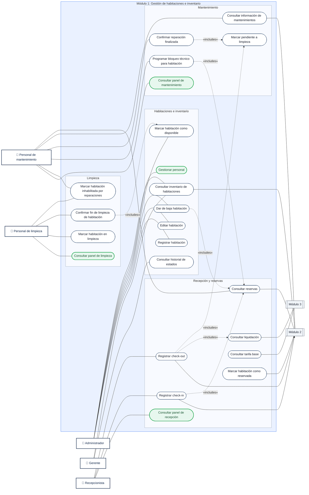

# Diagrama de casos de uso — Módulo 1

Versión en Mermaid de `cdu-modulo-1-d.drawio`, con los casos de uso que tienen SPEC en `documentos/SPEC/`:

- Agrega los tres paneles (recepción, limpieza y mantenimiento) y *Gestionar personal*, que no estaban en el diagrama original (en verde). Los casos se agrupan por área solo para que el diagrama se lea mejor.
- Corrige "Personal de manteniento".

Las líneas continuas unen a cada actor con los casos de uso que usa; las punteadas son `<<includes>>`.

