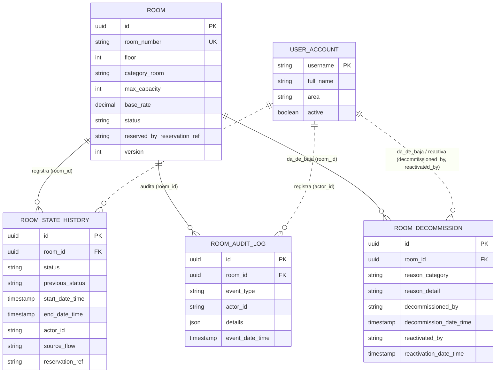
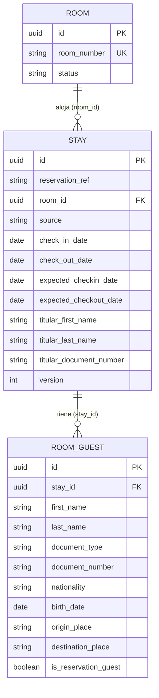
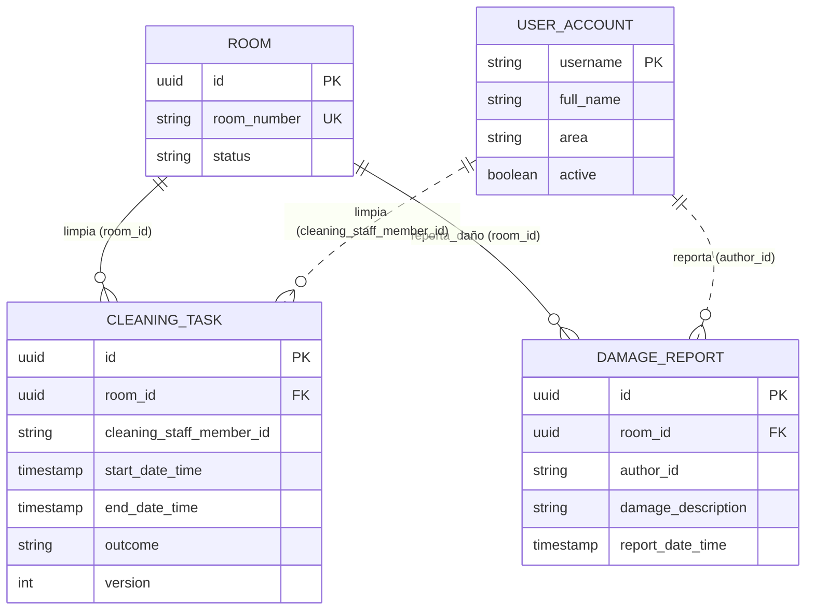
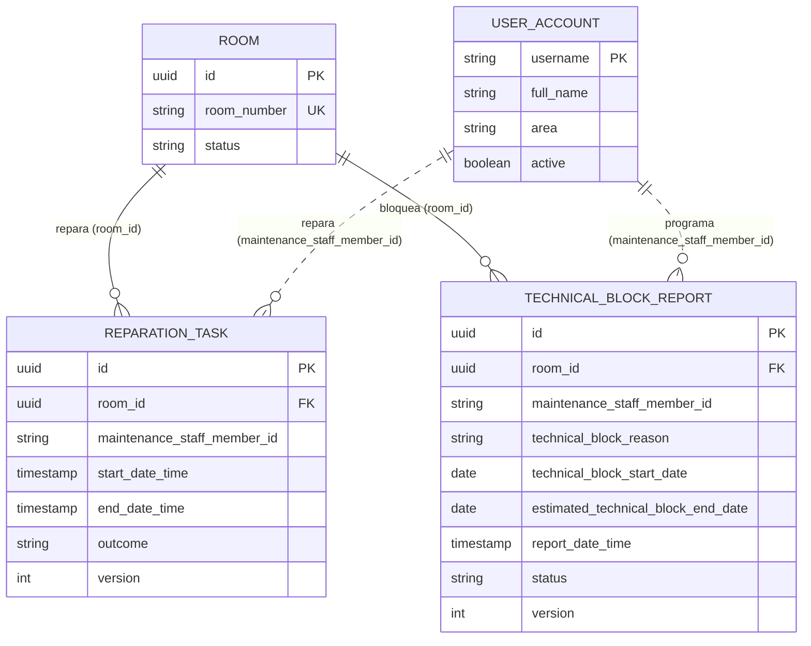
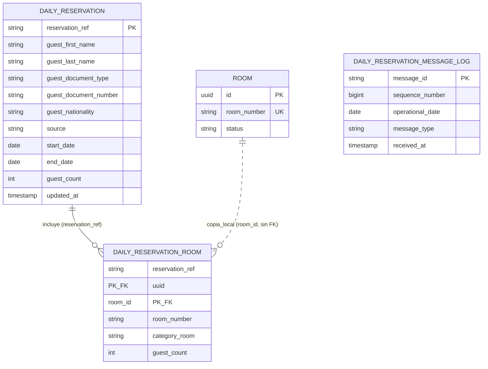
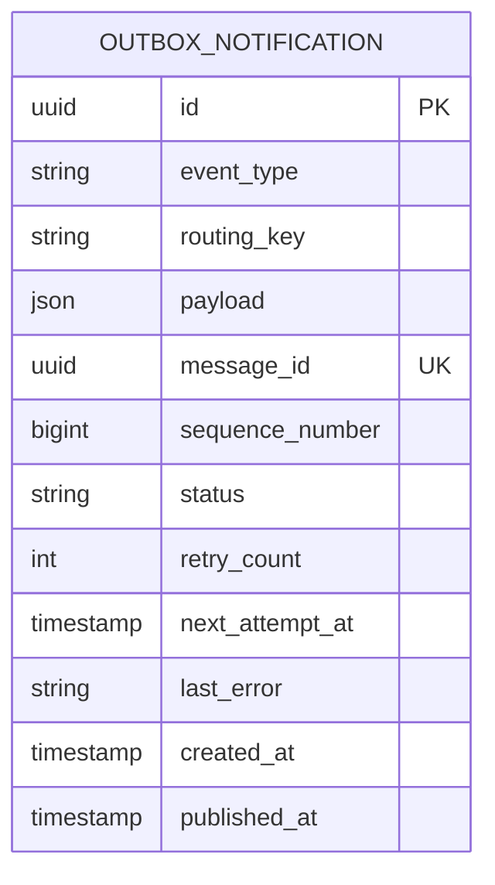
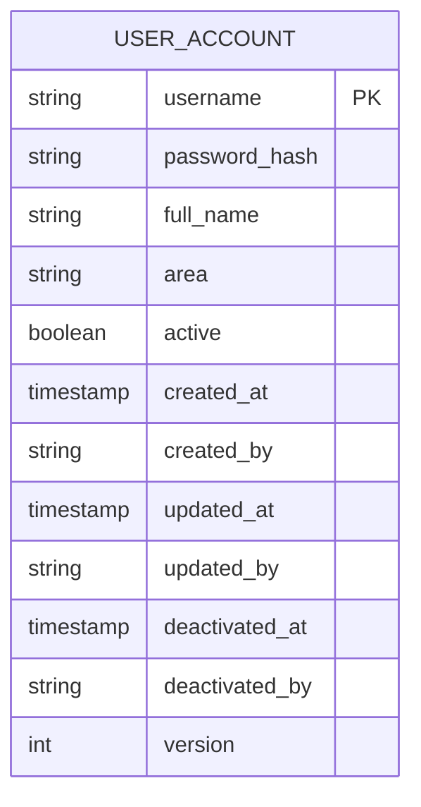

# Diagrama Entidad-Relación — Módulo 1

**Fuente canónica**: `documentos/PLAN/base/plan.md` (Modelo de Datos Relacional).
**Última actualización**: 2026-10-21.

> Tipos simplificados: `uuid`, `date`, `decimal`, `json`, `boolean`, `int`, `string`.  
> **Línea continua** = FK real en BD · **Línea punteada** = relación lógica (campo cadena, sin FK declarada).  
> Los campos de usuario (`actor_id`, `decommissioned_by`, `reactivated_by`, `cleaning_staff_member_id`, `maintenance_staff_member_id`, `author_id`) guardan el `username` de `user_account` sin FK.

---

## 1. Inventario físico — `room` y sus registros asociados

---

## 2. Check-In / Check-Out — `stay` y `room_guest`

---

## 3. Limpieza — `cleaning_task` y `damage_report`

---

## 4. Mantenimiento — `reparation_task` y `technical_block_report`

---

## 5. Copia local de reservas — `daily_reservation`, `daily_reservation_room` y log

---

## 6. Mensajería asíncrona — `outbox_notification`

> Sin FK declarada. Se vincula con la estancia y habitación a través del campo `payload` (JSONB).  
> Se inserta en la misma transacción ACID que el cambio físico de estado.

---

## 7. Personal y seguridad — `user_account`

---

## Resumen de tablas por grupo

| # | Grupo | Tablas |
|---|---|---|
| 1 | **Inventario físico** | `room`, `room_state_history`, `room_audit_log`, `room_decommission` |
| 2 | **Check-In / Check-Out** | `stay`, `room_guest` |
| 3 | **Limpieza** | `cleaning_task`, `damage_report` |
| 4 | **Mantenimiento** | `reparation_task`, `technical_block_report` |
| 5 | **Copia local de reservas** | `daily_reservation`, `daily_reservation_room`, `daily_reservation_message_log` |
| 6 | **Mensajería asíncrona** | `outbox_notification` |
| 7 | **Personal / Seguridad** | `user_account` |
